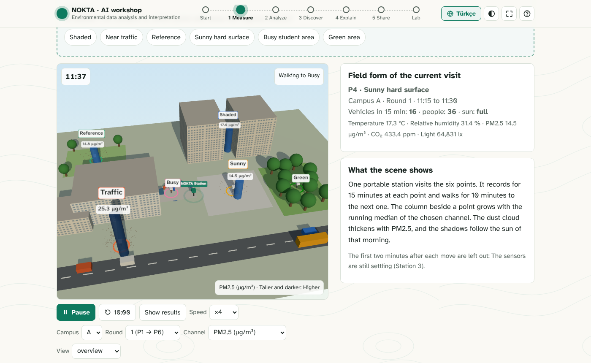
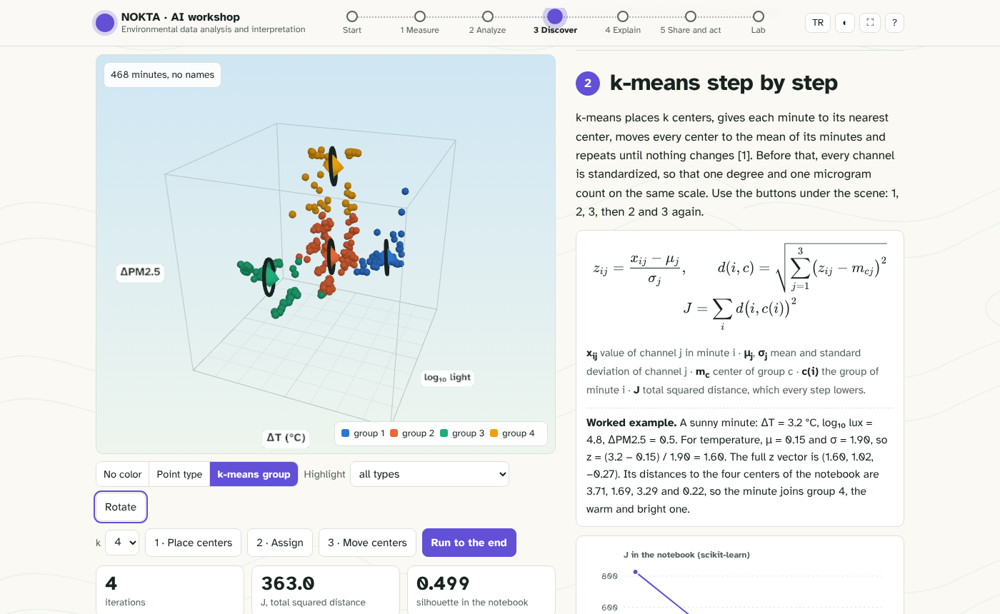
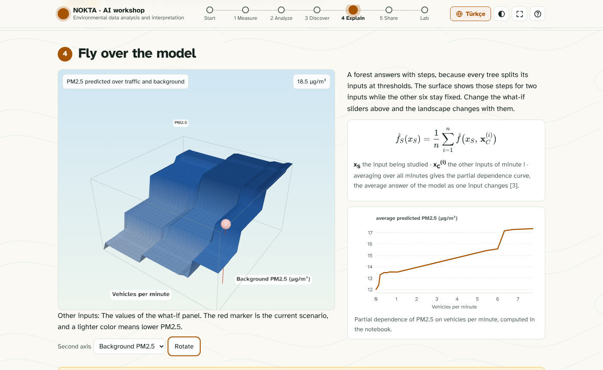

<div align="center">

**English** &nbsp;|&nbsp; [**Türkçe**](README.tr.md)

# AI-Based Environmental Data Analysis and Interpretation

### From Campus Sensor Readings to Evidence and Action

**NOKTA Workshop · ÜNİDES 2026**<br>
NOKTA, Objective Measurement, Participation, Monitoring and Action Network<br>
SDÜ Robotics and Innovation Community · Ankara University · İzmir Institute of Technology<br>
20 November 2026 · two hours · English and Turkish

**English**

<a href="https://utkukose.github.io/env-data-ai-nokta2026-NB-workshop/"></a>&nbsp;&nbsp;
<a href="https://colab.research.google.com/github/utkukose/env-data-ai-nokta2026-NB-workshop/blob/main/notebooks/NOKTA_AI_Workshop_EN.ipynb"></a>

**Türkçe** · Bu sayfanın, sitenin ve Colab defterinin Türkçesi

<a href="README.tr.md"></a>&nbsp;&nbsp;
<a href="https://utkukose.github.io/env-data-ai-nokta2026-NB-workshop/tr/"></a>&nbsp;&nbsp;
<a href="https://colab.research.google.com/github/utkukose/env-data-ai-nokta2026-NB-workshop/blob/main/notebooks/NOKTA_AI_Workshop_TR.ipynb"></a>

[](#)
[](#acknowledgments)
[](#program)
[](README.tr.md)
[](#the-colab-notebook)
[](https://github.com/utkukose/env-data-ai-nokta2026-NB-workshop/actions/workflows/notebooks.yml)
[](LICENSE-CONTENT)
[](LICENSE)

**This workshop is updated in line with current developments in the field. First version: November 2026.**

**Prof. Dr. Utku Köse**<br>
Full Professor, Department of Computer Engineering, Süleyman Demirel University, Isparta, Türkiye<br>
Founding Director, AI Application and Research Center (YAZEM), Süleyman Demirel University<br>
Head of the Computer Science Division, Department of Computer Engineering, Süleyman Demirel University<br>
Additional affiliations: University of North Dakota (USA), Universidad Panamericana (Mexico City, Mexico), Vel Tech University (Chennai, India)<br>
IEEE Senior Member · ACM Professional Member

[](https://orcid.org/0000-0002-9652-6415)
[](https://www.utkukose.com)
[](https://github.com/utkukose)

[utkukose@sdu.edu.tr](mailto:utkukose@sdu.edu.tr) · [utku.kose@und.edu](mailto:utku.kose@und.edu) · [ukose@up.edu.mx](mailto:ukose@up.edu.mx) · [utkukose@gmail.com](mailto:utkukose@gmail.com)

**[Türkçe sürüm için tıklayın: README.tr.md](README.tr.md)**

</div>

---

<p align="center">
<a href="https://utkukose.github.io/env-data-ai-nokta2026-NB-workshop/"></a><br>
<sub>The start page of the workshop site. A schematic 3D campus shows the six NOKTA point types with the two-round mean of the chosen channel.</sub>
</p>

## About

This repository contains the complete material of the two-hour workshop *AI-Based Environmental Data Analysis and Interpretation* (*Yapay Zekâ ile Çevresel Veri Analizi ve Yorumlama*). The workshop belongs to NOKTA, Objective Measurement, Participation, Monitoring and Action Network, a project of university students on climate and the campus environment. NOKTA is carried out by the Süleyman Demirel University (SDÜ) Robotics and Innovation Community with partner communities at Ankara University and the İzmir Institute of Technology. It is supported by ÜNİDES, the University Student Communities Cooperation and Support Program of the Ministry of Youth and Sports of the Republic of Türkiye.

In NOKTA, teams on three campuses carry a portable NOKTA Station to six fixed point types. The station measures temperature, relative humidity, air pressure, PM1, PM2.5, PM10, carbon dioxide (CO₂), light, UVA and UVB. Each campus runs two field rounds, and the second round reverses the order of the points. The approach of the project is *Measure → Analyze → Share → Turn into action*. The workshop takes place on 20 November 2026, the last day of the second field round. It prepares the teams for the analysis days of 21 to 24 November and for the NOKTA National Youth Environment and Climate Congress and Environment Workshop on 28 November.

The session follows such data from the first reading to a solution proposal. It shows where artificial intelligence (AI) helps, where it misleads and how a careful analyst keeps it honest. The steps are robust quality control, fair comparisons, unsupervised learning in 3D, an explainable model with an honest test, and AI-assisted reporting with a number audit. All material exists in English and Turkish.

## Use in other courses and workshops

These materials may be used, adapted and run in other courses and workshops at any level, with attribution. The Colab notebook reads real NOKTA files with one change of setting, so other student teams can repeat the analysis on their own campus. Corrections and suggestions are welcome through the repository's issues. During an active delivery of the workshop, questions can be sent to utkukose@sdu.edu.tr or utkukose@gmail.com.

## How the session works

Each part follows the same rhythm. **Predict:** a short page on the [workshop site](https://utkukose.github.io/env-data-ai-nokta2026-NB-workshop/) asks a question before anything is shown. **Reveal and explore:** animations and 3D scenes show what the data say, and every formula comes with a worked example in numbers. **Code:** the orange boxes open the matching section of the Colab notebook, which reproduces every number of the page in Python. The NOKTA Lab closes the session with all 3D tools on one bench and a debrief built from what each browser did.

## Program

| Time | Part | Interactive page | Colab notebook |
|---|---|---|---|
| 0:00 to 0:08 | Opening: Six points, one station, two rounds | [Start page](https://utkukose.github.io/env-data-ai-nokta2026-NB-workshop/) | Section 0 |
| 0:08 to 0:30 | **Part 1 · Measure.** The campus as data | [part1.html](https://utkukose.github.io/env-data-ai-nokta2026-NB-workshop/part1.html) | Section 1 |
| 0:30 to 0:52 | **Part 2 · Analyze.** Fair comparisons | [part2.html](https://utkukose.github.io/env-data-ai-nokta2026-NB-workshop/part2.html) | Section 2 |
| 0:52 to 0:57 | Break (key `B` on any page) | | |
| 0:57 to 1:17 | **Part 3 · Discover.** AI finds patterns | [part3.html](https://utkukose.github.io/env-data-ai-nokta2026-NB-workshop/part3.html) | Section 3 |
| 1:17 to 1:37 | **Part 4 · Explain.** Why is it high here? | [part4.html](https://utkukose.github.io/env-data-ai-nokta2026-NB-workshop/part4.html) | Section 4 |
| 1:37 to 1:55 | **Part 5 · Share and turn into action.** From numbers to words to action | [part5.html](https://utkukose.github.io/env-data-ai-nokta2026-NB-workshop/part5.html) | Section 5 |
| 1:55 to 2:00 | **NOKTA Lab.** Debrief and questions | [lab.html](https://utkukose.github.io/env-data-ai-nokta2026-NB-workshop/lab.html) | |

The run sheet with the timings, the questions for a live poll and a fallback plan is in [WORKSHOP_GUIDE.md](WORKSHOP_GUIDE.md) ([Turkish](WORKSHOP_GUIDE.tr.md)). The PDF notes follow the pages station by station, with the formulas, worked examples and answers: [English](notes/NOKTA_Workshop_Notes_EN.pdf) and [Turkish](notes/NOKTA_Atolye_Notlari_TR.pdf). Every page has a Turkish twin under [`/tr/`](https://utkukose.github.io/env-data-ai-nokta2026-NB-workshop/tr/), and the key `L` switches the language.

## The interactive pages

| Page | What participants do |
|---|---|
| **Part 1 · Measure** | Replay a field round in a 3D campus twin with the sun, the traffic and a dust cloud that follows PM2.5, read the ten channels, play data doctor on 10-second streams with a robust z-score, align three stations from their side-by-side test and watch humid air swell particles in an optical sensor. |
| **Part 2 · Analyze** | See why the last stop of a morning looks warm, how the reversed second round removes the clock from the comparison, why the median beats the mean near smokers, how a correlation of +0.81 turns negative inside each campus, and whether the air is wetter or only colder. |
| **Part 3 · Discover** | Rotate 468 clean minutes in 3D, run k-means step by step in the browser, compress six channels with principal component analysis and name the groups. |
| **Part 4 · Explain** | Watch a random forest lose 41 percent of its score when whole points are held out, predict which input matters most, play what-if with traffic, people and background, and fly over the model's answer as a 3D surface. |
| **Part 5 · Share and act** | Catch six errors in an AI-written paragraph, build a safe prompt from the fact table, weigh claims from observed to unsupported, and write a solution card for the three tables of the NOKTA Environment Workshop. |
| **NOKTA Lab** | The campus twin, the microclimate groups and the model surface on one bench, and a printable field report of the session. |

<table>
<tr>
<td width="50%"><a href="https://utkukose.github.io/env-data-ai-nokta2026-NB-workshop/part1.html"></a></td>
<td width="50%"><a href="https://utkukose.github.io/env-data-ai-nokta2026-NB-workshop/part2.html"></a></td>
</tr>
<tr>
<td><sub>Part 1. One station walks the six points, and the columns grow with the running median.</sub></td>
<td><sub>Part 2. Round 1 and the reversed Round 2 against the clock, before the fair result.</sub></td>
</tr>
<tr>
<td width="50%"><a href="https://utkukose.github.io/env-data-ai-nokta2026-NB-workshop/part3.html"></a></td>
<td width="50%"><a href="https://utkukose.github.io/env-data-ai-nokta2026-NB-workshop/part4.html"></a></td>
</tr>
<tr>
<td><sub>Part 3. k-means converges in the browser on the same minutes as the notebook.</sub></td>
<td><sub>Part 4. A forest answers in steps: PM2.5 over traffic and background.</sub></td>
</tr>
<tr>
<td width="50%"><a href="https://utkukose.github.io/env-data-ai-nokta2026-NB-workshop/part5.html"></a></td>
<td width="50%"><a href="https://utkukose.github.io/env-data-ai-nokta2026-NB-workshop/lab.html"></a></td>
</tr>
<tr>
<td><sub>Part 5. Six of nine sentences would not survive a check against the fact table.</sub></td>
<td><sub>The NOKTA Lab keeps the 3D tools together for the analysis days.</sub></td>
</tr>
</table>

All pages run in the browser and send nothing anywhere. The 3D scenes use three.js, which is bundled in the repository, so the site also works offline from a local copy. On every page the arrow keys move between stations, and `[` and `]` move between parts. `T` switches between the paper view and the night view, `F` toggles full screen, `L` switches the language, `B` starts a five-minute break and `?` lists the keys. The random forest of Part 4 runs in the browser from the 40 trees exported by `tools/build_site_data.py`, which checks that the JavaScript predictions match scikit-learn.

To publish the site, enable GitHub Pages in the repository settings with the source *Deploy from a branch*, branch `main`, folder `/docs`.

## The Colab notebook

One notebook carries the whole session, in two parallel language versions. It runs on a free Colab CPU in under a minute, needs no installation and downloads the data itself.

| Section | Part | Methods |
|---|---|---|
| 0 · Setup and data | Opening | data loading, switch to your own NOKTA files, a five-idea Python step |
| 1 · Measure | Part 1 | modified z-score, physical plausibility rules, Isolation Forest, missing values, co-location offsets, κ-Köhler humidity correction, clean minutes |
| 2 · Analyze | Part 2 | visit medians, two-round mean, difference from the reference point, box plots, pooled and within-group correlation, dew point |
| 3 · Discover | Part 3 | standardization, k-means, J and the silhouette, principal component analysis, interactive 3D plots |
| 4 · Explain | Part 4 | random forest, random and leave-one-point-out cross-validation, permutation importance, what-if sliders, partial dependence, 3D surface |
| 5 · Share and act | Part 5 | fact table, safe prompt, number auditor, solution card |

Six exercises give instant feedback, and the reference solutions sit in folded cells. A table of application challenges invites students of engineering, health sciences, social sciences, communication, economics and education to continue with their own question.

## The data

The workshop runs on a synthetic dataset that follows the NOKTA field protocol, generated by [`tools/make_synthetic_data.py`](tools/make_synthetic_data.py) with a fixed seed. It describes no real campus, and its numbers must not be quoted as findings. The three campuses are called A, B and C: An inland highland, a continental city and a coastal campus. NOKTA does not rank universities or cities, and neither does the workshop.

| File | Content |
|---|---|
| `data/nokta_synthetic.csv` | 3,240 readings: 3 campuses × 6 points × 2 rounds × 15 minutes, one reading every 10 seconds, ten channels |
| `data/nokta_field_forms_synthetic.csv` | 36 field forms: Times, vehicles and people in 15 minutes, sun, green cover, notes |
| `data/nokta_colocation_synthetic.csv` | two hours of the three stations side by side, one reading per minute |
| `data/nokta_synthetic_qc_truth.csv` | the problems planted on purpose, for scoring the quality control |
| `data/nokta_template.csv` | the column schema for real NOKTA files |

The planted problems are realistic for low-cost sensors: Two minutes of settling after each move, single-channel glitches, a frozen CO₂ sensor, logger dropouts, a light sensor at its 16-bit limit and particle readings inflated by humid air. The data dictionary is in [data/README.md](data/README.md).

## Running the materials

**Online.** Open the [workshop site](https://utkukose.github.io/env-data-ai-nokta2026-NB-workshop/) and the Colab notebook from the orange buttons. Nothing else is needed.

**Local installation.**

```bash
git clone https://github.com/utkukose/env-data-ai-nokta2026-NB-workshop.git
cd env-data-ai-nokta2026-NB-workshop
python -m venv .venv && source .venv/bin/activate
pip install -r requirements.txt
jupyter lab notebooks/
```

The site needs no build step: `docs/index.html` opens directly from disk.

**Rebuilding everything.** The data, the page numbers, the pages, the notebooks and the PDF notes come from one pipeline:

```bash
(cd tools/node && npm install)        # once: KaTeX, three.js and the font for the build tools
python tools/make_synthetic_data.py   # data/*.csv
python tools/build_site_data.py       # docs/assets/site-data.js, checks the exported forest
python tools/build_site.py            # docs/*.html and docs/tr/*.html, formulas rendered with KaTeX
python tools/build_notebooks.py       # notebooks/*.ipynb, functions copied from tools/nokta_core.py
python tools/run_notebooks.py         # runs both notebooks end to end
python tools/check_site.py            # opens every page in Chrome, reports errors and overflow
python tools/build_notes.py           # notes/*.pdf, with Word copies outside the repository
```

The build tools need the Python packages of `tools/requirements-build.txt` in addition. `build_site.py` needs Node.js and the packages installed in `tools/node`. `node tools/node/build_vendor.js` refreshes the bundled three.js, KaTeX and font files in `docs/assets/vendor/`. `check_site.py` needs Playwright and Chrome, and `build_notes.py` needs pdflatex, Poppler and LibreOffice.

## Repository structure

```
env-data-ai-nokta2026-NB-workshop/
├── index.html, 404.html          open the site in docs/ from the repository address
├── docs/                         the workshop site for GitHub Pages
│   ├── index.html, part1.html … part5.html, lab.html   English pages
│   ├── tr/                       Turkish pages
│   ├── assets/                   site.css, site.js, charts.js, nokta3d.js, site-data.js
│   │   └── vendor/               three.js, KaTeX and the Atkinson Hyperlegible font
│   └── images/                   screenshots used in this README
├── notebooks/
│   ├── NOKTA_AI_Workshop_EN.ipynb
│   └── NOKTA_AI_Workshop_TR.ipynb
├── data/                         synthetic NOKTA dataset and the column template
├── notes/                        PDF notes in English and Turkish
├── tools/
│   ├── make_synthetic_data.py    generates the dataset
│   ├── nokta_core.py             analysis functions shared by notebooks and site
│   ├── build_site_data.py        computes every number of the pages
│   ├── build_site.py             builds the bilingual pages from tools/site_src/
│   ├── build_notebooks.py        builds the bilingual notebooks
│   ├── run_notebooks.py          executes both notebooks
│   ├── check_site.py             loads every page and reports errors
│   ├── build_notes.py            builds the PDF notes from the pages
│   └── node/                     KaTeX rendering and the vendor bundle (npm)
├── .github/workflows/notebooks.yml   runs the notebooks on every push
├── WORKSHOP_GUIDE.md · WORKSHOP_GUIDE.tr.md   run sheet, polls and fallback plan
├── REFERENCES.md                 consolidated references
├── README.tr.md                  Turkish version of this page
├── CITATION.cff · LICENSE (MIT) · LICENSE-CONTENT (CC BY 4.0)
└── requirements.txt
```

## Design principles

Every number on a page comes from the same code and seeds as the notebook, so a result met in the browser reappears in Colab. Every formula is followed by the meaning of its symbols, its units and a worked example in numbers. Methods are shown with their limits: The detector misses two glitches, the clusters are hypotheses, the importances describe the model rather than the world, and the honest test lowers the score. AI is used as a magnifying glass for the data and as a writing assistant under rules, never as the source of a number.

## Related material

The two IEEE CARS 2026 workshops of the same author share the format: [xai-cars2026-NB-workshop](https://github.com/utkukose/xai-cars2026-NB-workshop) on explainable AI in medical systems and [ticket-zero-cars2026-NB-workshop](https://github.com/utkukose/ticket-zero-cars2026-NB-workshop) on the security of AI assistants. All references are collected in [REFERENCES.md](REFERENCES.md).

## Citation

```bibtex
@misc{kose2026noktaai,
  author       = {K{\"o}se, Utku},
  title        = {AI-Based Environmental Data Analysis and Interpretation:
                  From Campus Sensor Readings to Evidence and Action},
  howpublished = {Workshop materials, NOKTA: Objective Measurement, Participation,
                  Monitoring and Action Network (ÜNİDES 2026)},
  address      = {Isparta, Türkiye},
  year         = {2026},
  month        = nov,
  url          = {https://github.com/utkukose/env-data-ai-nokta2026-NB-workshop}
}
```

A machine-readable citation is in `CITATION.cff`.

## License

The source code is licensed under the MIT License ([`LICENSE`](LICENSE)). The workshop content, including this page, the interactive site, the notebooks' text, the guides and the screenshots, is licensed under Creative Commons Attribution 4.0 International ([`LICENSE-CONTENT`](LICENSE-CONTENT)). The bundled three.js and KaTeX keep their MIT licenses, and the bundled Atkinson Hyperlegible font keeps the SIL Open Font License 1.1. All three licenses are in `docs/assets/vendor/`.

## References cited on this page

The methods of the pages and notebooks rest on the following works, cited in full in [REFERENCES.md](REFERENCES.md) and on each page: The modified z-score [1], Isolation Forest [2], the humidity response of low-cost particle sensors [3, 4, 5], the WHO air quality guidelines [6], the global CO₂ background [7], the urban energy balance [8], the Magnus form of the dew point [9], k-means [10], the silhouette [11], scikit-learn [12], principal component analysis [13], cross-validation for structured data [14], random forests [15], partial dependence [16] and hallucination in language generation [17].

## Human-AI collaboration

This workshop was developed through human-AI collaboration. Human intellectual knowledge and expertise are the fundamental starting point of the workshop. The author guides and supervises every stage of its development. The final version is presented only after the author's review and approval.

---

<div align="center">

**Prof. Dr. Utku Köse**<br>
Süleyman Demirel University · University of North Dakota · Universidad Panamericana · Vel Tech University<br>
[utkukose.com](https://www.utkukose.com) · [ORCID 0000-0002-9652-6415](https://orcid.org/0000-0002-9652-6415) · [github.com/utkukose](https://github.com/utkukose)

<sub>NOKTA workshop · ÜNİDES 2026 · 20 November 2026 · First version: November 2026</sub>

</div>

## Acknowledgments

This workshop was prepared for NOKTA, Objective Measurement, Participation, Monitoring and Action Network. NOKTA is carried out by the SDÜ Robotics and Innovation Community under the coordination of Enes Şenol, with the Ankara University Energy and Environment Student Community and the İzmir Institute of Technology Environment Community. The project is supported by ÜNİDES, the University Student Communities Cooperation and Support Program of the Ministry of Youth and Sports of the Republic of Türkiye. Thanks are due to the NOKTA teams, whose field rounds give the workshop its purpose, and to the maintainers of NumPy, pandas, scikit-learn, Matplotlib, Plotly, ipywidgets, three.js and KaTeX.
