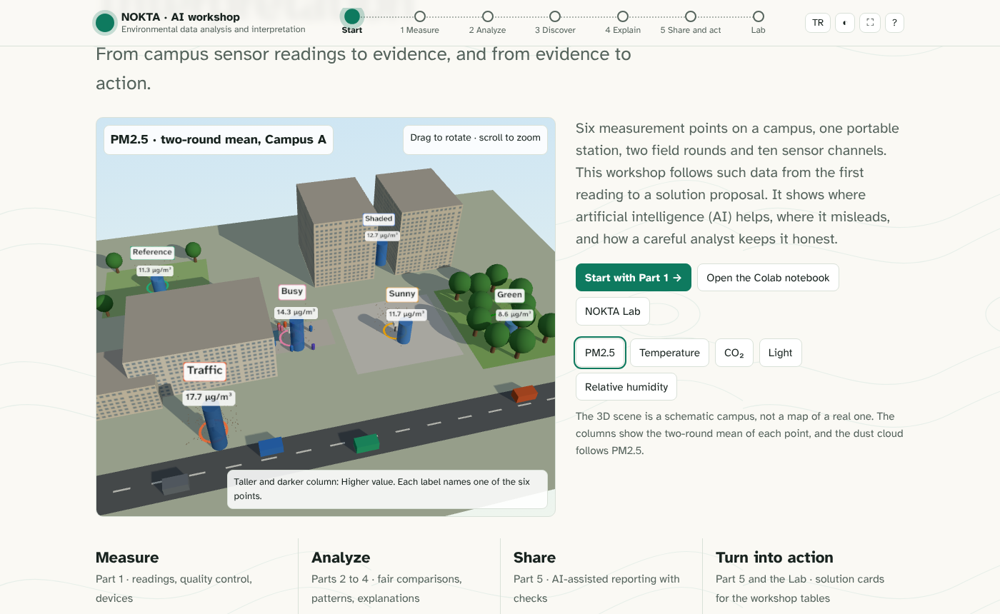
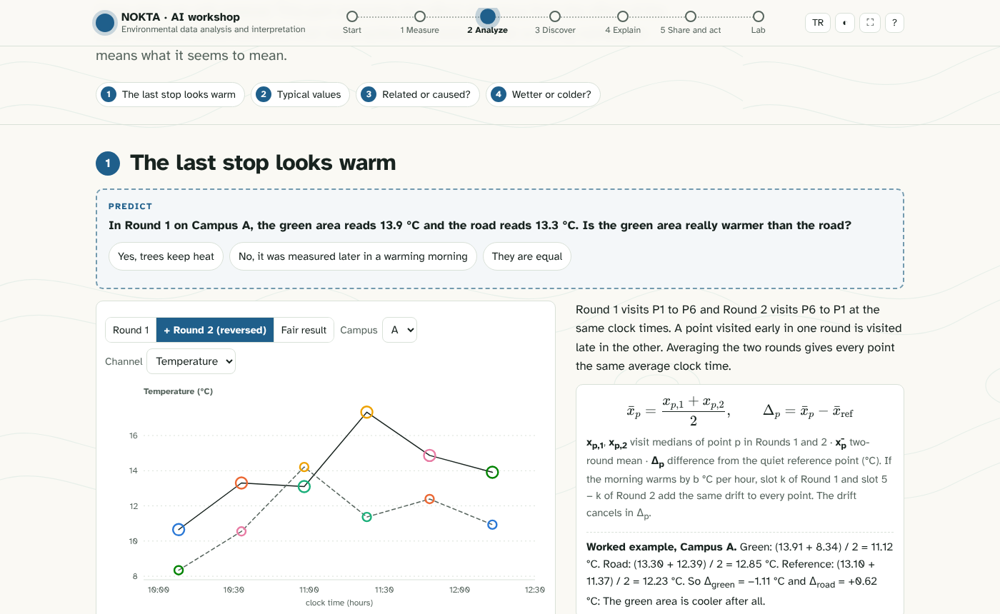
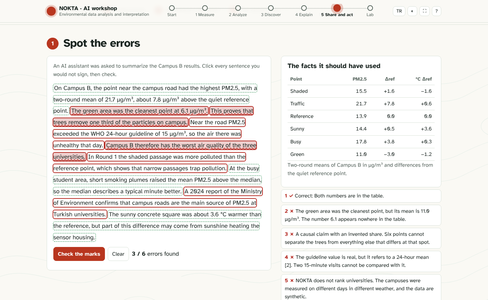
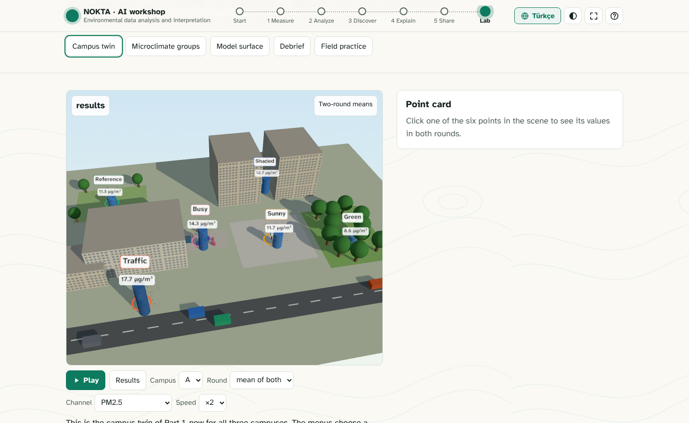

<div align="center">

**English** &nbsp;|&nbsp; [**Türkçe**](README.tr.md)

# AI-Based Environmental Data Analysis and Interpretation

### From Campus Sensor Readings to Evidence and Action

**NOKTA Workshop · ÜNİDES 2026**<br>
NOKTA, Objective Measurement, Participation, Monitoring and Action Network<br>
SDÜ Robotics and Innovation Community · Ankara University · İzmir Institute of Technology<br>
20 November 2026 · two hours · English and Turkish

**English**

<a href="https://utkukose.github.io/env-data-ai-nokta2026-NB-workshop/"></a>&nbsp;&nbsp;
<a href="https://colab.research.google.com/github/utkukose/env-data-ai-nokta2026-NB-workshop/blob/main/notebooks/NOKTA_AI_Workshop_EN.ipynb"></a>

**Türkçe** · Bu sayfanın, sitenin ve Colab defterinin Türkçesi

<a href="README.tr.md"></a>&nbsp;&nbsp;
<a href="https://utkukose.github.io/env-data-ai-nokta2026-NB-workshop/tr/"></a>&nbsp;&nbsp;
<a href="https://colab.research.google.com/github/utkukose/env-data-ai-nokta2026-NB-workshop/blob/main/notebooks/NOKTA_AI_Workshop_TR.ipynb"></a>

[](#)
[](#acknowledgments)
[](#program)
[](README.tr.md)
[](#the-colab-notebook)
[](https://github.com/utkukose/env-data-ai-nokta2026-NB-workshop/actions/workflows/notebooks.yml)
[](LICENSE-CONTENT)
[](LICENSE)

**This workshop is updated in line with current developments in the field. First version: November 2026.**

**Prof. Dr. Utku Köse**<br>
Full Professor, Department of Computer Engineering, Süleyman Demirel University, Isparta, Türkiye<br>
Founding Director, AI Application and Research Center (YAZEM), Süleyman Demirel University<br>
Head of the Computer Science Division, Department of Computer Engineering, Süleyman Demirel University<br>
Additional affiliations: University of North Dakota (USA), Universidad Panamericana (Mexico City, Mexico), Vel Tech University (Chennai, India)<br>
IEEE Senior Member · ACM Professional Member

[](https://orcid.org/0000-0002-9652-6415)
[](https://www.utkukose.com)
[](https://github.com/utkukose)

[utkukose@sdu.edu.tr](mailto:utkukose@sdu.edu.tr) · [utku.kose@und.edu](mailto:utku.kose@und.edu) · [ukose@up.edu.mx](mailto:ukose@up.edu.mx) · [utkukose@gmail.com](mailto:utkukose@gmail.com)

**[Türkçe sürüm için tıklayın: README.tr.md](README.tr.md)**

</div>

---

<p align="center">
<a href="https://utkukose.github.io/env-data-ai-nokta2026-NB-workshop/"></a>
</p>

*The start page of the workshop site.* The 3D scene is a schematic campus, not the map of a real one. It shows the six NOKTA point types where they usually occur on a campus: A shaded passage between two buildings, a point next to the campus road, a quiet lawn used as the reference, a sunny concrete square, a busy faculty entrance and a path under a row of trees. The column above each point gives the two-round mean of the chosen channel, here PM2.5 on Campus A. A taller and darker column means a higher value, and the label gives the number. In this synthetic example the point next to the road has the highest mean, 17.7 µg/m³, and the green area the lowest, 8.6 µg/m³.

## About

This repository contains the complete material of the two-hour workshop *AI-Based Environmental Data Analysis and Interpretation* (*Yapay Zekâ ile Çevresel Veri Analizi ve Yorumlama*). The workshop belongs to NOKTA, Objective Measurement, Participation, Monitoring and Action Network, a project of university students on climate and the campus environment. NOKTA is carried out by the Süleyman Demirel University (SDÜ) Robotics and Innovation Community with partner communities at Ankara University and the İzmir Institute of Technology. It is supported by ÜNİDES, the University Student Communities Cooperation and Support Program of the Ministry of Youth and Sports of the Republic of Türkiye.

In NOKTA, teams on three campuses carry a portable NOKTA Station to six fixed point types. The station measures temperature, relative humidity, air pressure, PM1, PM2.5, PM10, carbon dioxide (CO₂), light, UVA and UVB. Each campus runs two field rounds, and the second round reverses the order of the points. The approach of the project is *Measure → Analyze → Share → Turn into action*. The workshop takes place on 20 November 2026, the last day of the second field round. It prepares the teams for the analysis days of 21 to 24 November and for the NOKTA National Youth Environment and Climate Congress and Environment Workshop on 28 November.

The session follows such a dataset from the first raw reading to a solution proposal. Along the way it shows where artificial intelligence (AI) really helps the analysis, where it can mislead and which checks keep the conclusions reliable. The five parts cover quality control with robust statistics, fair comparisons between points, the discovery of patterns with unsupervised learning, an explainable model that is tested honestly, and AI-assisted reporting in which every number is checked. All material exists in English and Turkish.

## Use in other courses and workshops

These materials may be used, adapted and run in other courses and workshops at any level, with attribution. The Colab notebook reads real NOKTA files with one change of setting, so other student teams can repeat the analysis on their own campus. Corrections and suggestions are welcome through the repository's issues. During an active delivery of the workshop, questions can be sent to utkukose@sdu.edu.tr or utkukose@gmail.com.

## How the session works

Each part of the session follows the same rhythm. **Predict:** Most stations of the [workshop site](https://utkukose.github.io/env-data-ai-nokta2026-NB-workshop/) open with a short question that the participants answer before anything is shown. Their intuition can then be compared with what the data say. **Reveal and explore:** The page shows the answer with an animation, a chart or a 3D scene. Every formula is followed by the meaning of its symbols, its units and a worked example in numbers. **Code:** The orange boxes open the matching section of the Colab notebook, which reproduces every number of the page in Python. At the end, the NOKTA Lab gathers all 3D tools on one page and writes a short field report from the answers given during the session.

## Program

| Time | Part | Interactive page | Colab notebook |
|---|---|---|---|
| 0:00 to 0:08 | Opening: Six points, one station, two rounds | [Start page](https://utkukose.github.io/env-data-ai-nokta2026-NB-workshop/) | Section 0 |
| 0:08 to 0:30 | **Part 1 · Measure.** The campus as data | [part1.html](https://utkukose.github.io/env-data-ai-nokta2026-NB-workshop/part1.html) | Section 1 |
| 0:30 to 0:52 | **Part 2 · Analyze.** Fair comparisons | [part2.html](https://utkukose.github.io/env-data-ai-nokta2026-NB-workshop/part2.html) | Section 2 |
| 0:52 to 0:57 | Break (key `B` on any page) | | |
| 0:57 to 1:17 | **Part 3 · Discover.** AI finds patterns | [part3.html](https://utkukose.github.io/env-data-ai-nokta2026-NB-workshop/part3.html) | Section 3 |
| 1:17 to 1:37 | **Part 4 · Explain.** Why is it high here? | [part4.html](https://utkukose.github.io/env-data-ai-nokta2026-NB-workshop/part4.html) | Section 4 |
| 1:37 to 1:55 | **Part 5 · Share and turn into action.** From numbers to words to action | [part5.html](https://utkukose.github.io/env-data-ai-nokta2026-NB-workshop/part5.html) | Section 5 |
| 1:55 to 2:00 | **NOKTA Lab.** Debrief, field practice and questions | [lab.html](https://utkukose.github.io/env-data-ai-nokta2026-NB-workshop/lab.html) | |

The run sheet with the timings, the questions for a live poll and a fallback plan is in [WORKSHOP_GUIDE.md](WORKSHOP_GUIDE.md) ([Turkish](WORKSHOP_GUIDE.tr.md)). The PDF notes follow the pages station by station, with the formulas, worked examples and answers: [English](notes/NOKTA_Workshop_Notes_EN.pdf) and [Turkish](notes/NOKTA_Atolye_Notlari_TR.pdf). Every page has a Turkish twin under [`/tr/`](https://utkukose.github.io/env-data-ai-nokta2026-NB-workshop/tr/), and the key `L` switches the language.

## The interactive pages

The workshop site has seven pages: The start page, the five parts and the NOKTA Lab. Each part is divided into numbered stations, and each station explains one idea with a short text, a formula where one is needed and an interactive visual. The subsections below describe what each part covers. A screenshot then shows one station of each part, and the paragraph under it explains what the screenshot contains.

### Part 1 · Measure: The campus as data

Part 1 turns the field protocol into data and checks the quality of the readings before any analysis. The first station replays a field round in a 3D campus twin, so the route of the station and the build-up of each reading can be followed point by point. The second station introduces the ten sensor channels with their units and typical ranges, and asks why the air pressure differs so much between the campuses. The third station shows the typical faults of low-cost sensors in the 10-second readings: The warm-up after each move, single-channel spikes, a frozen CO₂ sensor and missing values. A robust z-score and a few physical rules mark these faults, and the marks are compared with the problems that were planted in the data on purpose. The fourth station removes the small offsets between the three stations, which were measured in a side-by-side test before the field rounds. The fifth station shows how humid air swells the particles that an optical sensor counts, and how the κ-Köhler formula corrects the reading.

<p align="center"><a href="https://utkukose.github.io/env-data-ai-nokta2026-NB-workshop/part1.html"></a></p>

*In the screenshot,* the replay of Round 1 on Campus A has reached its fourth stop, the sunny point, which the station visited from 11:15 to 11:30. The clock in the upper left corner of the scene gives the time of the replay. The label in the upper right corner gives the minute of the current visit. The column of each point shows the running median of PM2.5 there, that is, the middle value of all readings taken so far. A column therefore stops growing once its visit is over. The point next to the road has the tallest column, 25.3 µg/m³, and the dust cloud is thickest there. On the right, the field form of the current visit gives the vehicles and people counted in 15 minutes and the readings of that moment.

### Part 2 · Analyze: Fair comparisons

Part 2 shows that clean data can still mislead when two effects are mixed. The air warms during the morning, so the point visited last can look warmer only because it was measured later. The first station shows how the second round removes this effect. Round 2 visits the same points in reverse order one week later, so the average of the two rounds gives every point the same average clock time. The second station uses box plots to show why the median describes a typical minute better than the mean when short smoke plumes pass. The third station finds that warmer minutes come with higher air pressure over all campuses together (r = +0.81), while the relation is negative inside each campus. The campus is the hidden third factor, a case known as Simpson's paradox. The fourth station uses the dew point to tell air that holds more water apart from air that is only colder.

<p align="center"><a href="https://utkukose.github.io/env-data-ai-nokta2026-NB-workshop/part2.html"></a></p>

*In the screenshot,* the first station plots the temperature of the six points of Campus A against the clock. Each dot is the median of one visit, placed at its clock time and colored by its point type. The solid line joins the visits of Round 1, which went from P1 to P6, and the dashed line joins those of Round 2, which went from P6 to P1. The order of the points changes from one round to the other, so a single round cannot separate the effect of the place from the effect of the hour. The button *Fair result* then shows the difference of each point from the reference point, averaged over both rounds.

### Part 3 · Discover: AI finds patterns

Part 3 lets an unsupervised algorithm look for patterns without being told the right answer. The 468 clean minutes of all campuses form a cloud in a rotating 3D space. Each minute is placed by three channels: Its temperature difference from the campus-round median, the logarithm of its light level and its PM2.5 difference. The k-means algorithm groups these minutes without knowing where they were measured. The buttons under the scene run its steps one at a time, and two numbers measure the result: The total squared distance J and the silhouette. Principal component analysis (PCA) then compresses six standardized channels into three new axes that keep about 86 % of the variation. In the last station each group card gives the center of the group in sensor units and the share of each point type among its minutes. The participants choose a name for each group, such as *Hot and bright* or *Smoke and exhaust plumes*, and the page checks the choices.

<p align="center"><a href="https://utkukose.github.io/env-data-ai-nokta2026-NB-workshop/part3.html"></a></p>

*In the screenshot,* k-means has run to the end with k = 4, which took four iterations. Each dot is one clean minute, and its color shows the group of its nearest center. The black rings mark the four centers. Below the scene, J = 363.0 is the total squared distance between the minutes and their centers, which every step of the algorithm lowers. The value 0.499 is the silhouette of the same grouping in the notebook, a measure between −1 and 1 of how well the groups are separated. The menu *Highlight* can pick out a single point type to show which groups its minutes fell into.

### Part 4 · Explain: Why is it high here?

Part 4 builds a model that explains PM2.5 and tests it honestly. A random forest is a set of decision trees whose answers are averaged. Here it predicts the PM2.5 of each minute from eight inputs: The vehicles and people per minute, the green cover, the sunshine, the relative humidity, the temperature, the hour and the background PM2.5 of the day. The first station compares three scores of the same model. On its own training minutes it reaches R² = 0.66 and on random test minutes 0.54. With whole measurement points held out, the score falls to 0.32, which is 41 percent below the random test. Only this last score tells how well the model would do at a new place. The second station asks which input the model relies on most and answers with permutation importance. The third station offers what-if sliders and ready scenarios, such as a quiet lawn or a bus stop. The fourth station draws the answer of the model as a 3D surface over two inputs, next to a partial dependence curve.

<p align="center"><a href="https://utkukose.github.io/env-data-ai-nokta2026-NB-workshop/part4.html"></a></p>

*In the screenshot,* the surface shows the PM2.5 that the forest predicts for every combination of vehicles per minute and background PM2.5. All other inputs keep the values of the scenario *Bus stop*, chosen in the what-if panel, and the red marker shows this scenario with a prediction of 18.5 µg/m³. The surface rises in steps, because every tree splits its inputs at threshold values. On the right, the partial dependence curve gives the average prediction over all minutes for each number of vehicles per minute.

### Part 5 · Share and turn into action: From numbers to words to action

Part 5 uses generative AI for reporting and keeps one rule throughout. The numbers come from the analysis, the words may come from the AI, and the judgment stays with the team. The first station gives a summary of Campus B in nine sentences, written by an AI assistant. Six of the sentences contain an error, such as an invented number, a cause that the data cannot show or a source that does not exist. The second station builds a prompt that hands the assistant the fact table of a campus, the study design and seven rules. The third station sorts claims on a ladder from *observed* through *associated* and *needs an intervention* to *not supported*. The fourth station writes a solution card for one of the three thematic tables of the NOKTA National Environment Workshop on 28 November.

<p align="center"><a href="https://utkukose.github.io/env-data-ai-nokta2026-NB-workshop/part5.html"></a></p>

*In the screenshot,* three sentences were marked and then checked. All three break the fact table or the study design: An invented value for the green area, a claim that trees remove one third of the particles, and a ranking of Campus B among the universities. After the check, every sentence with an error gets a red frame and every correct sentence a dashed green frame. The counter shows that three of the six errors were found, and the explanations on the right say what is wrong in each sentence. The fact table above them lists the only numbers that the assistant was allowed to use.

### NOKTA Lab

The NOKTA Lab gathers the three 3D tools of the session on one page: The campus twin, the cloud of minutes with its groups and the surface of the model. It serves for questions in the last minutes of the workshop and for the analysis days of 21 to 24 November. A fourth tab, the debrief, writes a short field report from the answers and steps recorded in the browser during the session. The report can be printed or saved as a PDF file.

The session itself does not ask anyone to go out and measure. A fifth tab, *Field practice*, therefore lists six short tasks that carry the methods of the session onto a real campus. They range from watching the warm-up of a sensor to filling a field form and asking ten students where the air feels worst. When the workshop is held in person, the teams can do them right after the session. When it is held online, or when the session is watched later, the tasks can be done on any campus at a convenient time.

<p align="center"><a href="https://utkukose.github.io/env-data-ai-nokta2026-NB-workshop/lab.html"></a></p>

*In the screenshot,* the campus twin of the lab shows the two-round means of PM2.5 on Campus A. The buttons above the scene switch between the five tabs of the lab, the last of which holds the field practice. The menus under the scene choose the campus, a single round or the mean of both rounds, the channel and the speed of the replay. A click on a point opens its card on the right with the values of both rounds.

### Working with the pages

All pages run in the browser and send nothing anywhere. The 3D scenes use three.js, which is bundled in the repository, so the site also works offline from a local copy. On every page the arrow keys move between stations, and `[` and `]` move between parts. `T` switches between the paper view and the night view, `F` toggles full screen, `L` switches the language, `B` starts a five-minute break and `?` lists the keys. The random forest of Part 4 runs in the browser from the 40 trees exported by `tools/build_site_data.py`, which checks that the JavaScript predictions match scikit-learn.

The site is published with GitHub Pages from the branch `main`. Either folder can serve as the source. With `/docs` the pages are served directly. With the root folder, the files `index.html` and `404.html` forward every address to the same page under `docs/`.

## The Colab notebook

One notebook carries the whole session, in two parallel language versions. It runs on a free Colab CPU in under a minute, needs no installation and downloads the data itself.

| Section | Part | Methods |
|---|---|---|
| 0 · Setup and data | Opening | data loading, switch to your own NOKTA files, a five-idea Python step |
| 1 · Measure | Part 1 | modified z-score, physical plausibility rules, Isolation Forest, missing values, co-location offsets, κ-Köhler humidity correction, clean minutes |
| 2 · Analyze | Part 2 | visit medians, two-round mean, difference from the reference point, box plots, pooled and within-group correlation, dew point |
| 3 · Discover | Part 3 | standardization, k-means, J and the silhouette, principal component analysis, interactive 3D plots |
| 4 · Explain | Part 4 | random forest, random and leave-one-point-out cross-validation, permutation importance, what-if sliders, partial dependence, 3D surface |
| 5 · Share and act | Part 5 | fact table, safe prompt, number auditor, solution card |

The notebook contains six exercises, from the robust z-score of Exercise 1.A to the number auditor of Exercise 5.A. Each exercise cell checks the answer as soon as it runs and says whether it is right, and a reference solution sits in a folded cell below it. A table of application challenges at the end suggests a next question for students of engineering, health sciences, social sciences, communication, economics and education. Each team can thus continue the analysis from its own field.

## The data

The workshop runs on a synthetic dataset that follows the NOKTA field protocol, generated by [`tools/make_synthetic_data.py`](tools/make_synthetic_data.py) with a fixed seed. It describes no real campus, and its numbers must not be quoted as findings. The three campuses are called A, B and C: An inland highland, a continental city and a coastal campus. NOKTA does not rank universities or cities, and neither does the workshop.

| File | Content |
|---|---|
| `data/nokta_synthetic.csv` | 3,240 readings: 3 campuses × 6 points × 2 rounds × 15 minutes, one reading every 10 seconds, ten channels |
| `data/nokta_field_forms_synthetic.csv` | 36 field forms: Times, vehicles and people in 15 minutes, sun, green cover, notes |
| `data/nokta_colocation_synthetic.csv` | two hours of the three stations side by side, one reading per minute |
| `data/nokta_synthetic_qc_truth.csv` | the problems planted on purpose, for scoring the quality control |
| `data/nokta_template.csv` | the column schema for real NOKTA files |

The planted problems are realistic for low-cost sensors: Two minutes of settling after each move, single-channel glitches, a frozen CO₂ sensor, logger dropouts, a light sensor at its 16-bit limit and particle readings inflated by humid air. The data dictionary is in [data/README.md](data/README.md).

## Running the materials

**Online.** Open the [workshop site](https://utkukose.github.io/env-data-ai-nokta2026-NB-workshop/) and the Colab notebook from the orange buttons. Nothing else is needed.

**Local installation.**

```bash
git clone https://github.com/utkukose/env-data-ai-nokta2026-NB-workshop.git
cd env-data-ai-nokta2026-NB-workshop
python -m venv .venv && source .venv/bin/activate
pip install -r requirements.txt
jupyter lab notebooks/
```

The site needs no build step: `docs/index.html` opens directly from disk.

**Rebuilding everything.** The data, the page numbers, the pages, the notebooks and the PDF notes come from one pipeline:

```bash
(cd tools/node && npm install)        # once: KaTeX, three.js and the font for the build tools
python tools/make_synthetic_data.py   # data/*.csv
python tools/build_site_data.py       # docs/assets/site-data.js, checks the exported forest
python tools/build_site.py            # docs/*.html and docs/tr/*.html, formulas rendered with KaTeX
python tools/build_notebooks.py       # notebooks/*.ipynb, functions copied from tools/nokta_core.py
python tools/run_notebooks.py         # runs both notebooks end to end
python tools/check_site.py            # opens every page in Chrome, reports errors and overflow
python tools/build_notes.py           # notes/*.pdf, with Word copies outside the repository
```

The build tools need the Python packages of `tools/requirements-build.txt` in addition. `build_site.py` needs Node.js and the packages installed in `tools/node`. `node tools/node/build_vendor.js` refreshes the bundled three.js, KaTeX and font files in `docs/assets/vendor/`. `check_site.py` needs Playwright and Chrome, and `build_notes.py` needs pdflatex, Poppler and LibreOffice.

## Repository structure

```
env-data-ai-nokta2026-NB-workshop/
├── index.html, 404.html          open the site in docs/ from the repository address
├── docs/                         the workshop site for GitHub Pages
│   ├── index.html, part1.html … part5.html, lab.html   English pages
│   ├── tr/                       Turkish pages
│   ├── assets/                   site.css, site.js, charts.js, nokta3d.js, site-data.js
│   │   └── vendor/               three.js, KaTeX and the Atkinson Hyperlegible font
│   └── images/                   screenshots used in this README
├── notebooks/
│   ├── NOKTA_AI_Workshop_EN.ipynb
│   └── NOKTA_AI_Workshop_TR.ipynb
├── data/                         synthetic NOKTA dataset and the column template
├── notes/                        PDF notes in English and Turkish
├── tools/
│   ├── make_synthetic_data.py    generates the dataset
│   ├── nokta_core.py             analysis functions shared by notebooks and site
│   ├── build_site_data.py        computes every number of the pages
│   ├── build_site.py             builds the bilingual pages from tools/site_src/
│   ├── build_notebooks.py        builds the bilingual notebooks
│   ├── run_notebooks.py          executes both notebooks
│   ├── check_site.py             loads every page and reports errors
│   ├── build_notes.py            builds the PDF notes from the pages
│   └── node/                     KaTeX rendering and the vendor bundle (npm)
├── .github/workflows/notebooks.yml   runs the notebooks on every push
├── WORKSHOP_GUIDE.md · WORKSHOP_GUIDE.tr.md   run sheet, polls and fallback plan
├── REFERENCES.md                 consolidated references
├── README.tr.md                  Turkish version of this page
├── CITATION.cff · LICENSE (MIT) · LICENSE-CONTENT (CC BY 4.0)
└── requirements.txt
```

## Design principles

Every number on a page comes from the same code and seed values as the notebook, so a result met in the browser reappears in Colab. Every formula is followed by the meaning of its symbols, its units and a worked example in numbers. Methods are shown together with their limits. The detector of Part 1 misses two PM2.5 glitches that occur inside real plumes, and the groups of Part 3 are hypotheses to be checked against the field forms. The importances of Part 4 describe the model rather than the world, and the honest test lowers the score of the model. AI is used to look at the data more closely and as a writing assistant under clear rules, but it is never the source of a number.

## Related material

The two IEEE CARS 2026 workshops of the same author share the format: [xai-cars2026-NB-workshop](https://github.com/utkukose/xai-cars2026-NB-workshop) on explainable AI in medical systems and [ticket-zero-cars2026-NB-workshop](https://github.com/utkukose/ticket-zero-cars2026-NB-workshop) on the security of AI assistants. All references are collected in [REFERENCES.md](REFERENCES.md).

## Citation

```bibtex
@misc{kose2026noktaai,
  author       = {K{\"o}se, Utku},
  title        = {AI-Based Environmental Data Analysis and Interpretation:
                  From Campus Sensor Readings to Evidence and Action},
  howpublished = {Workshop materials, NOKTA: Objective Measurement, Participation,
                  Monitoring and Action Network (ÜNİDES 2026)},
  address      = {Isparta, Türkiye},
  year         = {2026},
  month        = nov,
  url          = {https://github.com/utkukose/env-data-ai-nokta2026-NB-workshop}
}
```

A machine-readable citation is in `CITATION.cff`.

## License

The source code is licensed under the MIT License ([`LICENSE`](LICENSE)). The workshop content, including this page, the interactive site, the notebooks' text, the guides and the screenshots, is licensed under Creative Commons Attribution 4.0 International ([`LICENSE-CONTENT`](LICENSE-CONTENT)). The bundled three.js and KaTeX keep their MIT licenses, and the bundled Atkinson Hyperlegible font keeps the SIL Open Font License 1.1. All three licenses are in `docs/assets/vendor/`.

## References cited on this page

The methods of the pages and notebooks rest on the following works, cited in full in [REFERENCES.md](REFERENCES.md) and on each page: The modified z-score [1], Isolation Forest [2], the humidity response of low-cost particle sensors [3, 4, 5], the WHO air quality guidelines [6], the global CO₂ background [7], the urban energy balance [8], the Magnus form of the dew point [9], k-means [10], the silhouette [11], scikit-learn [12], principal component analysis [13], cross-validation for structured data [14], random forests [15], partial dependence [16] and hallucination in language generation [17].

## Human-AI collaboration

This workshop was developed through human-AI collaboration. Human intellectual knowledge and expertise are the fundamental starting point of the workshop. The author guides and supervises every stage of its development. The final version is presented only after the author's review and approval.

---

<div align="center">

**Prof. Dr. Utku Köse**<br>
Süleyman Demirel University · University of North Dakota · Universidad Panamericana · Vel Tech University<br>
[utkukose.com](https://www.utkukose.com) · [ORCID 0000-0002-9652-6415](https://orcid.org/0000-0002-9652-6415) · [github.com/utkukose](https://github.com/utkukose)

<sub>NOKTA workshop · ÜNİDES 2026 · 20 November 2026 · First version: November 2026</sub>

</div>

## Acknowledgments

This workshop was prepared for NOKTA, Objective Measurement, Participation, Monitoring and Action Network. NOKTA is carried out by the SDÜ Robotics and Innovation Community under the coordination of Enes Şenol. Its partners are the Ankara University Energy and Environment Student Community and the İzmir Institute of Technology Environment Community. The project is supported by ÜNİDES, the University Student Communities Cooperation and Support Program of the Ministry of Youth and Sports of the Republic of Türkiye. Thanks are due to the NOKTA teams, whose field rounds give the workshop its purpose, and to the maintainers of NumPy, pandas, scikit-learn, Matplotlib, Plotly, ipywidgets, three.js and KaTeX.
