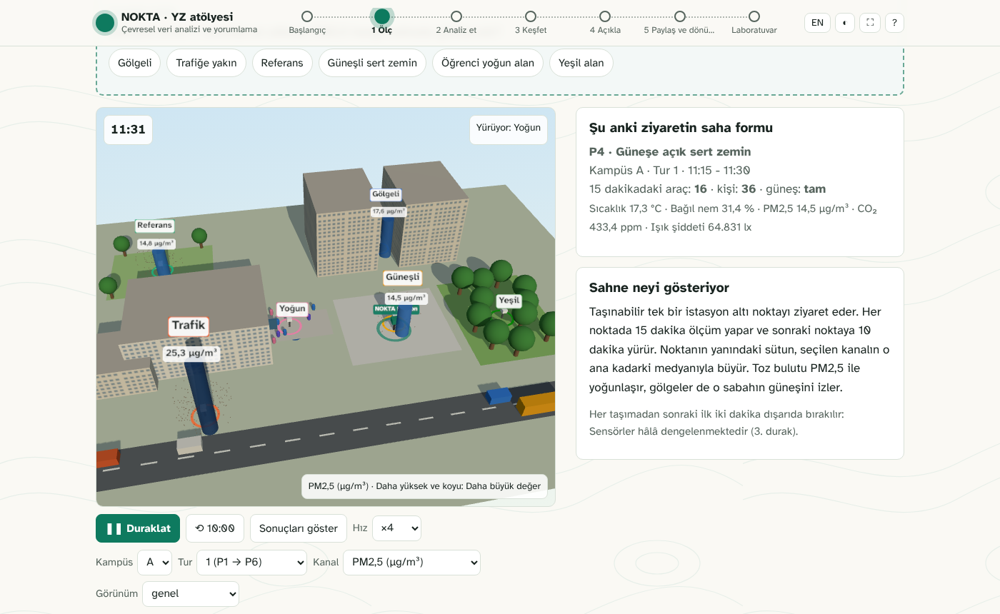

<div align="center">

# Yapay Zekâ ile Çevresel Veri Analizi ve Yorumlama

### Kampüs Sensör Verisinden Kanıta ve Aksiyona

**NOKTA Atölyesi · ÜNİDES 2026**<br>
NOKTA, Nesnel Ölçüm, Katılım, Takip ve Aksiyon Ağı<br>
SDÜ Robotik ve İnovasyon Topluluğu · Ankara Üniversitesi · İzmir Yüksek Teknoloji Enstitüsü<br>
20 Kasım 2026 · iki saat · Türkçe ve İngilizce

<a href="https://utkukose.github.io/env-data-ai-nokta2026-NB-workshop/tr/"></a>
&nbsp;&nbsp;
<a href="https://colab.research.google.com/github/utkukose/env-data-ai-nokta2026-NB-workshop/blob/main/notebooks/NOKTA_AI_Workshop_TR.ipynb"></a>

[](#)
[](#teşekkür)
[](#program)
[](README.md)
[](#colab-defteri)
[](LICENSE-CONTENT)
[](LICENSE)

**Bu atölye alandaki güncel gelişmelere göre güncellenmektedir. İlk sürüm: Kasım 2026.**

**Prof. Dr. Utku Köse**<br>
Profesör, Bilgisayar Mühendisliği Bölümü, Süleyman Demirel Üniversitesi, Isparta<br>
Kurucu Müdür, Yapay Zekâ Uygulama ve Araştırma Merkezi (YAZEM), Süleyman Demirel Üniversitesi<br>
Bilgisayar Bilimleri Anabilim Dalı Başkanı, Bilgisayar Mühendisliği Bölümü, Süleyman Demirel Üniversitesi<br>
Diğer afiliasyonlar: University of North Dakota (ABD), Universidad Panamericana (Meksiko, Meksika), Vel Tech University (Chennai, Hindistan)<br>
IEEE Senior Member · ACM Professional Member

[](https://orcid.org/0000-0002-9652-6415)
[](https://www.utkukose.com)
[](https://github.com/utkukose)

[utkukose@sdu.edu.tr](mailto:utkukose@sdu.edu.tr) · [utku.kose@und.edu](mailto:utku.kose@und.edu) · [ukose@up.edu.mx](mailto:ukose@up.edu.mx) · [utkukose@gmail.com](mailto:utkukose@gmail.com)

**[For the English version: README.md](README.md)**

</div>

---

<p align="center">
<a href="https://utkukose.github.io/env-data-ai-nokta2026-NB-workshop/tr/"></a><br>
<sub>Atölye sitesinin başlangıç sayfası. Şematik bir 3B kampüs, altı NOKTA nokta türünü seçilen kanalın iki tur ortalamasıyla gösterir.</sub>
</p>

## Hakkında

Bu depo, *Yapay Zekâ ile Çevresel Veri Analizi ve Yorumlama* başlıklı iki saatlik atölyenin bütün malzemesini içermektedir. Atölye, üniversite öğrencilerinin iklim ve kampüs çevresi üzerine yürüttüğü NOKTA, Nesnel Ölçüm, Katılım, Takip ve Aksiyon Ağı projesinin bir parçasıdır. NOKTA, Süleyman Demirel Üniversitesi (SDÜ) Robotik ve İnovasyon Topluluğu yürütücülüğünde, Ankara Üniversitesi ve İzmir Yüksek Teknoloji Enstitüsündeki partner topluluklarla birlikte yürütülmektedir. Proje, Gençlik ve Spor Bakanlığının Üniversite Öğrenci Toplulukları İş Birliği ve Destek Programı (ÜNİDES) tarafından desteklenmektedir.

NOKTA'da üç kampüsteki ekipler taşınabilir bir NOKTA Station ile altı sabit nokta türünde sıcaklık, bağıl nem, atmosfer basıncı, PM1, PM2,5, PM10, karbondioksit (CO₂), ışık şiddeti, UVA ve UVB ölçmektedir. Her kampüste iki saha turu yapılır ve ikinci turda noktaların sırası tersine çevrilir. Projenin yaklaşımı *Ölç → Analiz Et → Paylaş → Aksiyona Dönüştür* şeklindedir. Atölye, ikinci saha turunun son günü olan 20 Kasım 2026'da gerçekleştirilmektedir. Ekipleri 21-24 Kasım analiz günlerine ve 28 Kasım'daki NOKTA Ulusal Gençlik Çevre ve İklim Kongresi ile Ulusal Çevre Çalıştayına hazırlar.

Oturum böyle bir veriyi ilk ölçümden çözüm önerisine kadar izler. Yapay zekânın (YZ) nerede yardımcı olduğunu, nerede yanılttığını ve dikkatli bir analistin onu nasıl dürüst tuttuğunu gösterir: Dayanıklı kalite kontrolü, adil karşılaştırmalar, 3B gözetimsiz öğrenme, dürüst biçimde test edilen açıklanabilir bir model ve sayı denetimiyle YZ destekli raporlama. Bütün malzeme Türkçe ve İngilizce olarak hazırlanmıştır.

## Başka ders ve atölyelerde kullanım

Bu malzemeler atıf yapılarak her düzeyde başka ders ve atölyelerde kullanılabilir, uyarlanabilir ve yürütülebilir. Colab defteri tek bir ayar değişikliğiyle gerçek NOKTA dosyalarını okur. Böylece başka öğrenci ekipleri de analizi kendi kampüslerinde tekrarlayabilir. Düzeltme ve öneriler deponun issues bölümünden iletilebilir. Atölyenin etkin olarak yürütüldüğü dönemde sorular utkukose@sdu.edu.tr ya da utkukose@gmail.com adresine gönderilebilir.

## Oturum nasıl işler

Her bölüm aynı ritmi izler. **Tahmin edin:** [Atölye sitesindeki](https://utkukose.github.io/env-data-ai-nokta2026-NB-workshop/tr/) kısa bir sayfa, hiçbir şey gösterilmeden önce bir soru sorar. **Görün ve keşfedin:** Animasyonlar ve 3B sahneler verinin ne söylediğini gösterir. Her formülün ardından sayılarla çözülmüş bir örnek gelir. **Kodlayın:** Turuncu kutular Colab defterinin ilgili bölümünü açar ve defter sayfadaki her sayıyı Python ile yeniden üretir. NOKTA Laboratuvarı, bütün 3B araçları tek bir tezgâhta toplayarak ve her tarayıcının yaptıklarından bir değerlendirme üreterek oturumu kapatır.

## Program

| Süre | Bölüm | Etkileşimli sayfa | Colab defteri |
|---|---|---|---|
| 0:00-0:08 | Açılış: Altı nokta, bir istasyon, iki tur | [Başlangıç sayfası](https://utkukose.github.io/env-data-ai-nokta2026-NB-workshop/tr/) | 0. Bölüm |
| 0:08-0:30 | **1. Bölüm · Ölç.** Veri olarak kampüs | [part1.html](https://utkukose.github.io/env-data-ai-nokta2026-NB-workshop/tr/part1.html) | 1. Bölüm |
| 0:30-0:52 | **2. Bölüm · Analiz et.** Adil karşılaştırma | [part2.html](https://utkukose.github.io/env-data-ai-nokta2026-NB-workshop/tr/part2.html) | 2. Bölüm |
| 0:52-0:57 | Ara (her sayfada `B` tuşu) | | |
| 0:57-1:17 | **3. Bölüm · Keşfet.** YZ örüntü bulur | [part3.html](https://utkukose.github.io/env-data-ai-nokta2026-NB-workshop/tr/part3.html) | 3. Bölüm |
| 1:17-1:37 | **4. Bölüm · Açıkla.** Burada neden yüksek? | [part4.html](https://utkukose.github.io/env-data-ai-nokta2026-NB-workshop/tr/part4.html) | 4. Bölüm |
| 1:37-1:55 | **5. Bölüm · Paylaş ve aksiyona dönüştür.** Sayılardan kelimelere, kelimelerden aksiyona | [part5.html](https://utkukose.github.io/env-data-ai-nokta2026-NB-workshop/tr/part5.html) | 5. Bölüm |
| 1:55-2:00 | **NOKTA Laboratuvarı.** Değerlendirme ve sorular | [lab.html](https://utkukose.github.io/env-data-ai-nokta2026-NB-workshop/tr/lab.html) | |

Süreleri, canlı anket sorularını ve yedek planı içeren akış rehberi [WORKSHOP_GUIDE.tr.md](WORKSHOP_GUIDE.tr.md) dosyasındadır ([İngilizce](WORKSHOP_GUIDE.md)). PDF notları sayfaları durak durak izler ve formülleri, çözümlü örnekleri ve cevapları içerir: [Türkçe](notes/NOKTA_Atolye_Notlari_TR.pdf) ve [İngilizce](notes/NOKTA_Workshop_Notes_EN.pdf). Her sayfanın İngilizce bir eşi vardır ve `L` tuşu dili değiştirir.

## Etkileşimli sayfalar

| Sayfa | Katılımcıların yaptıkları |
|---|---|
| **1. Bölüm · Ölç** | Güneşin, trafiğin ve PM2,5 değerini izleyen bir toz bulutunun bulunduğu 3B kampüs ikizinde bir saha turunu yeniden oynatırlar. On kanalı okur, 10 saniyelik veri akışlarında dayanıklı z-skoruyla veri doktorluğu yapar, üç istasyonu yan yana testten hizalar ve nemli havanın optik sensördeki partikülleri nasıl şişirdiğini izlerler. |
| **2. Bölüm · Analiz et** | Sabahın son durağının neden sıcak göründüğünü, ters sıralı ikinci turun saati karşılaştırmadan nasıl çıkardığını, sigara içilen yerde medyanın neden ortalamadan iyi olduğunu, +0,81'lik bir korelasyonun her kampüsün içinde nasıl negatife döndüğünü ve havanın daha nemli mi yoksa yalnızca daha soğuk mu olduğunu görürler. |
| **3. Bölüm · Keşfet** | 468 temiz dakikayı 3B olarak döndürür, k-ortalamaları tarayıcıda adım adım çalıştırır, temel bileşen analiziyle altı kanalı sıkıştırır ve gruplara ad verirler. |
| **4. Bölüm · Açıkla** | Bütün noktalar dışarıda tutulduğunda bir rastgele ormanın skorunun yüzde 41 düştüğünü izler, en önemli girdiyi tahmin eder, trafik, insan ve arka planla senaryolar dener ve modelin cevabının üzerinde 3B bir yüzey olarak gezinirler. |
| **5. Bölüm · Paylaş ve dönüştür** | YZ ile yazılmış bir paragraftaki altı hatayı yakalar, olgu tablosundan güvenli bir istem kurar, iddiaları gözlenenden desteklenmeyene doğru tartar ve NOKTA Ulusal Çevre Çalıştayının üç masası için bir çözüm kartı yazarlar. |
| **NOKTA Laboratuvarı** | Kampüs ikizi, mikroiklim grupları ve model yüzeyi tek bir tezgâhtadır. Oturumun yazdırılabilir saha raporu da buradadır. |

<table>
<tr>
<td width="50%"><a href="https://utkukose.github.io/env-data-ai-nokta2026-NB-workshop/tr/part1.html"></a></td>
<td width="50%"><a href="https://utkukose.github.io/env-data-ai-nokta2026-NB-workshop/tr/part3.html"></a></td>
</tr>
<tr>
<td><sub>1. Bölüm. Tek istasyon altı noktayı dolaşır, sütunlar da o ana kadarki medyanla büyür.</sub></td>
<td><sub>3. Bölüm. k-ortalamalar tarayıcıda, defterdekiyle aynı dakikalar üzerinde yakınsar.</sub></td>
</tr>
</table>

Bütün sayfalar tarayıcıda çalışır ve hiçbir yere veri göndermez. 3B sahneler depoda bulunan three.js ile çalıştığı için site yerel bir kopyadan internetsiz de açılır. Her sayfada ok tuşları duraklar arasında, `[` ve `]` bölümler arasında geçiş yapar. `T` kâğıt ve gece görünümünü, `F` tam ekranı, `L` dili değiştirir, `B` beş dakikalık arayı başlatır ve `?` tuşları listeler. 4. Bölümdeki rastgele orman, `tools/build_site_data.py` tarafından aktarılan 40 ağaçla tarayıcıda çalışır. Aynı betik, JavaScript tahminlerinin scikit-learn ile aynı olduğunu da denetlemektedir.

Siteyi yayımlamak için depo ayarlarında GitHub Pages bölümünde *Deploy from a branch*, `main` dalı ve `/docs` klasörü seçilmelidir.

## Colab defteri

Bütün oturumu, iki paralel dil sürümüyle tek bir defter taşır. Ücretsiz Colab CPU'sunda bir dakikadan kısa sürede çalışır, kurulum gerektirmez ve veriyi kendisi indirir.

| Bölüm | Site | Yöntemler |
|---|---|---|
| 0 · Kurulum ve veri | Açılış | veri yükleme, kendi NOKTA dosyalarına geçiş, beş fikirlik Python adımı |
| 1 · Ölç | 1. Bölüm | değiştirilmiş z-skoru, fiziksel akla yatkınlık kuralları, Isolation Forest, eksik değerler, yan yana test sapmaları, κ-Köhler nem düzeltmesi, temiz dakikalar |
| 2 · Analiz et | 2. Bölüm | ziyaret medyanları, iki tur ortalaması, referans noktasından fark, kutu grafikleri, birleştirilmiş ve grup içi korelasyon, çiy noktası |
| 3 · Keşfet | 3. Bölüm | standartlaştırma, k-ortalamalar, J ve siluet, temel bileşen analizi, etkileşimli 3B grafikler |
| 4 · Açıkla | 4. Bölüm | rastgele orman, rastgele ve bir noktayı dışarıda bırakan çapraz doğrulama, permütasyon önemi, senaryo kaydırıcıları, kısmi bağımlılık, 3B yüzey |
| 5 · Paylaş ve dönüştür | 5. Bölüm | olgu tablosu, güvenli istem, sayı denetleyicisi, çözüm kartı |

Altı alıştırma anında geri bildirim verir ve örnek çözümler katlanmış hücrelerdedir. Uygulama görevleri tablosu da mühendislik, sağlık bilimleri, sosyal bilimler, iletişim, iktisat ve eğitim öğrencilerini kendi sorularıyla devam etmeye davet etmektedir.

## Veri

Atölye, NOKTA saha protokolünü izleyen ve [`tools/make_synthetic_data.py`](tools/make_synthetic_data.py) tarafından sabit bir seed değeriyle üretilen sentetik bir veri setiyle yürütülmektedir. Veri gerçek bir kampüsü anlatmaz ve sayıları bulgu olarak aktarılmamalıdır. Üç kampüs A, B ve C olarak adlandırılmıştır: İç kesimde yüksek bir kampüs, karasal bir şehir kampüsü ve bir kıyı kampüsü. NOKTA üniversiteleri ya da şehirleri sıralamaz, atölye de sıralamaz.

| Dosya | İçerik |
|---|---|
| `data/nokta_synthetic.csv` | 3.240 ölçüm: 3 kampüs × 6 nokta × 2 tur × 15 dakika, her 10 saniyede bir ölçüm, on kanal |
| `data/nokta_field_forms_synthetic.csv` | 36 saha formu: Saatler, 15 dakikadaki araç ve kişi sayısı, güneş durumu, yeşil örtü, notlar |
| `data/nokta_colocation_synthetic.csv` | üç istasyonun iki saatlik yan yana testi, dakikada bir ölçüm |
| `data/nokta_synthetic_qc_truth.csv` | kalite kontrolünü puanlamak için bilerek yerleştirilmiş sorunlar |
| `data/nokta_template.csv` | gerçek NOKTA dosyaları için sütun şablonu |

Yerleştirilmiş sorunlar düşük maliyetli sensörler için gerçekçidir: Her taşımadan sonra iki dakikalık dengelenme, tek kanallı hatalar, donmuş bir CO₂ sensörü, kayıt kesintileri, 16 bitlik sınırına ulaşmış bir ışık sensörü ve nemli havada şişen partikül ölçümleri. Veri sözlüğü [data/README.tr.md](data/README.tr.md) dosyasındadır.

## Malzemeleri çalıştırma

**Çevrim içi.** [Atölye sitesini](https://utkukose.github.io/env-data-ai-nokta2026-NB-workshop/tr/) ve turuncu düğmelerden Colab defterini açın. Başka bir şeye gerek yoktur.

**Yerel kurulum.**

```bash
git clone https://github.com/utkukose/env-data-ai-nokta2026-NB-workshop.git
cd env-data-ai-nokta2026-NB-workshop
python -m venv .venv && source .venv/bin/activate
pip install -r requirements.txt
jupyter lab notebooks/
```

Site herhangi bir derleme adımı gerektirmez: `docs/index.html` doğrudan diskten açılır. Veri, sayfa sayıları, sayfalar, defterler ve PDF notları tek bir zincirden üretilir. Komutlar [README.md](README.md#running-the-materials) dosyasında listelenmiştir. Formüller için gereken Node paketleri `tools/node` klasöründe bir kez `npm install` ile kurulmaktadır.

## Tasarım ilkeleri

Sayfadaki her sayı defterle aynı kod ve seed değerlerinden gelir. Bu yüzden tarayıcıda görülen bir sonuç Colab'da yeniden ortaya çıkar. Her formülün ardından sembollerin anlamı, birimleri ve sayılarla çözülmüş bir örnek gelir. Yöntemler sınırlarıyla birlikte gösterilir: Dedektör iki hatayı kaçırır, kümeler hipotezdir, önem değerleri dünyayı değil modeli anlatır ve dürüst test skoru düşürür. YZ, verinin büyüteci ve kurallara bağlı bir yazım yardımcısı olarak kullanılır, ancak hiçbir zaman bir sayının kaynağı olmaz.

## İlgili malzemeler

Aynı yazarın IEEE CARS 2026 atölyeleri aynı biçimi paylaşır: Tıbbi sistemlerde açıklanabilir YZ üzerine [xai-cars2026-NB-workshop](https://github.com/utkukose/xai-cars2026-NB-workshop) ve YZ asistanlarının güvenliği üzerine [ticket-zero-cars2026-NB-workshop](https://github.com/utkukose/ticket-zero-cars2026-NB-workshop). Bütün kaynaklar [REFERENCES.md](REFERENCES.md) dosyasında toplanmıştır.

## Atıf

Önerilen atıf: Köse, U. (2026). *AI-Based Environmental Data Analysis and Interpretation: From Campus Sensor Readings to Evidence and Action* [Workshop materials]. NOKTA, ÜNİDES 2026. GitHub. https://github.com/utkukose/env-data-ai-nokta2026-NB-workshop. BibTeX kaydı [README.md](README.md#citation) dosyasında, makine tarafından okunabilir atıf ise `CITATION.cff` dosyasındadır.

## Lisans

Kaynak kod MIT Lisansı ([`LICENSE`](LICENSE)) ile lisanslanmıştır. Bu sayfa, etkileşimli site, defter metinleri, rehberler ve ekran görüntüleri dâhil atölye içeriği Creative Commons Atıf 4.0 Uluslararası ([`LICENSE-CONTENT`](LICENSE-CONTENT)) lisansıyla sunulmaktadır. Depodaki three.js ve KaTeX kendi MIT lisanslarını, Atkinson Hyperlegible yazı tipi de SIL Open Font License 1.1 lisansını korur. Üç lisans da `docs/assets/vendor/` klasöründedir.

## İnsan-yapay zekâ işbirliği

Bu atölye insan-yapay zekâ işbirliğiyle geliştirilmiştir. İnsanın entelektüel birikimi ve uzmanlığı atölyenin temel çıkış noktasıdır. Yazar, geliştirmenin her aşamasını yönlendirmekte ve denetlemektedir. Nihai hâl, ancak yazarın incelemesi ve onayından sonra sunulmaktadır.

---

<div align="center">

**Prof. Dr. Utku Köse**<br>
Süleyman Demirel Üniversitesi · University of North Dakota · Universidad Panamericana · Vel Tech University<br>
[utkukose.com](https://www.utkukose.com) · [ORCID 0000-0002-9652-6415](https://orcid.org/0000-0002-9652-6415) · [github.com/utkukose](https://github.com/utkukose)

<sub>NOKTA atölyesi · ÜNİDES 2026 · 20 Kasım 2026 · İlk sürüm: Kasım 2026</sub>

</div>

## Teşekkür

Bu atölye, Enes Şenol koordinatörlüğünde SDÜ Robotik ve İnovasyon Topluluğu yürütücülüğünde, Ankara Üniversitesi Enerji ve Çevre Öğrenci Topluluğu ve İzmir Yüksek Teknoloji Enstitüsü Çevre Topluluğu ile birlikte yürütülen NOKTA, Nesnel Ölçüm, Katılım, Takip ve Aksiyon Ağı projesi için hazırlanmıştır. NOKTA, Gençlik ve Spor Bakanlığının Üniversite Öğrenci Toplulukları İş Birliği ve Destek Programı (ÜNİDES) tarafından desteklenmektedir. Saha turlarıyla atölyeye amacını veren NOKTA ekiplerine ve NumPy, pandas, scikit-learn, Matplotlib, Plotly, ipywidgets, three.js ile KaTeX geliştiricilerine teşekkür edilir.
