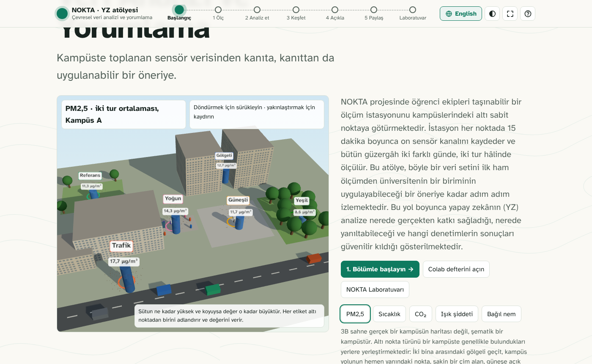
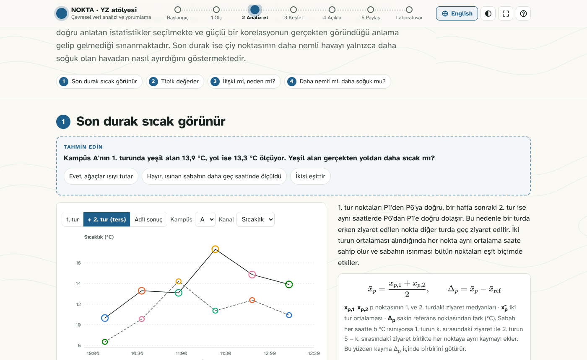
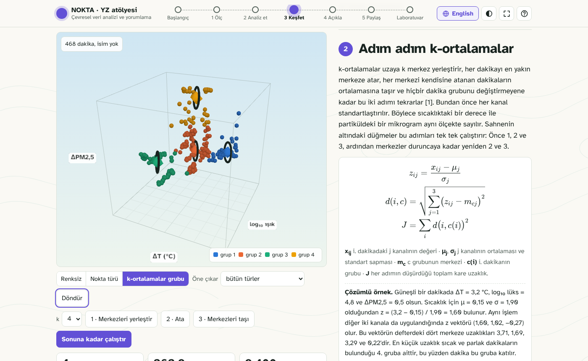
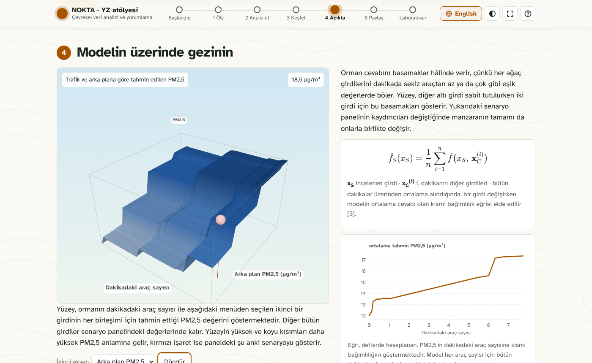
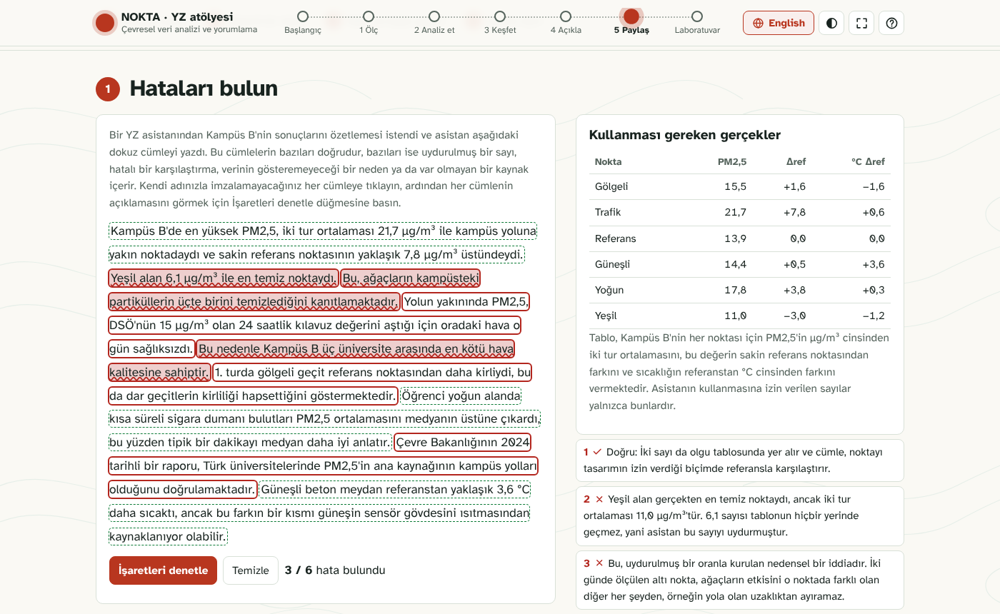
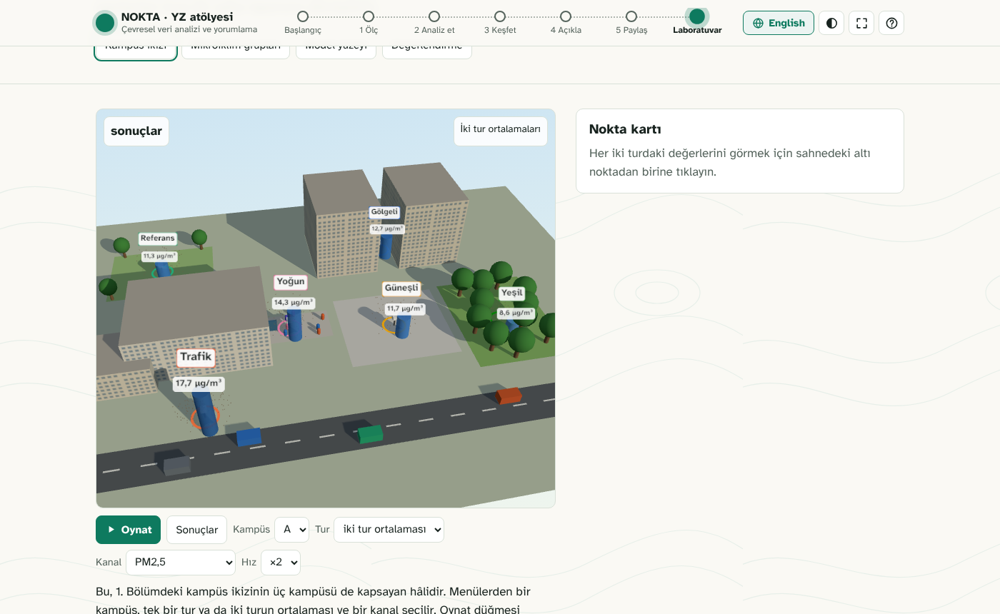

<div align="center">

[**English**](README.md) &nbsp;|&nbsp; **Türkçe**

# Yapay Zekâ ile Çevresel Veri Analizi ve Yorumlama

### Kampüs Sensör Verisinden Kanıta ve Aksiyona

**NOKTA Atölyesi · ÜNİDES 2026**<br>
NOKTA, Nesnel Ölçüm, Katılım, Takip ve Aksiyon Ağı<br>
SDÜ Robotik ve İnovasyon Topluluğu · Ankara Üniversitesi · İzmir Yüksek Teknoloji Enstitüsü<br>
20 Kasım 2026 · iki saat · Türkçe ve İngilizce

**Türkçe**

<a href="https://utkukose.github.io/env-data-ai-nokta2026-NB-workshop/tr/"></a>&nbsp;&nbsp;
<a href="https://colab.research.google.com/github/utkukose/env-data-ai-nokta2026-NB-workshop/blob/main/notebooks/NOKTA_AI_Workshop_TR.ipynb"></a>

**English** · The English version of this page, the site and the Colab notebook

<a href="README.md"></a>&nbsp;&nbsp;
<a href="https://utkukose.github.io/env-data-ai-nokta2026-NB-workshop/"></a>&nbsp;&nbsp;
<a href="https://colab.research.google.com/github/utkukose/env-data-ai-nokta2026-NB-workshop/blob/main/notebooks/NOKTA_AI_Workshop_EN.ipynb"></a>

[](#)
[](#teşekkür)
[](#program)
[](README.md)
[](#colab-defteri)
[](LICENSE-CONTENT)
[](LICENSE)

**Bu atölye alandaki güncel gelişmelere göre güncellenmektedir. İlk sürüm: Kasım 2026.**

**Prof. Dr. Utku Köse**<br>
Profesör, Bilgisayar Mühendisliği Bölümü, Süleyman Demirel Üniversitesi, Isparta<br>
Kurucu Müdür, Yapay Zekâ Uygulama ve Araştırma Merkezi (YAZEM), Süleyman Demirel Üniversitesi<br>
Bilgisayar Bilimleri Anabilim Dalı Başkanı, Bilgisayar Mühendisliği Bölümü, Süleyman Demirel Üniversitesi<br>
Diğer afiliasyonlar: University of North Dakota (ABD), Universidad Panamericana (Meksiko, Meksika), Vel Tech University (Chennai, Hindistan)<br>
IEEE Senior Member · ACM Professional Member

[](https://orcid.org/0000-0002-9652-6415)
[](https://www.utkukose.com)
[](https://github.com/utkukose)

[utkukose@sdu.edu.tr](mailto:utkukose@sdu.edu.tr) · [utku.kose@und.edu](mailto:utku.kose@und.edu) · [ukose@up.edu.mx](mailto:ukose@up.edu.mx) · [utkukose@gmail.com](mailto:utkukose@gmail.com)

**[For the English version: README.md](README.md)**

</div>

---

<p align="center">
<a href="https://utkukose.github.io/env-data-ai-nokta2026-NB-workshop/tr/"></a>
</p>

*Atölye sitesinin başlangıç sayfası.* 3B sahne gerçek bir kampüsün haritası değil, şematik bir kampüstür. Altı NOKTA nokta türü, bir kampüste genellikle bulundukları yerlere yerleştirilmiştir: İki bina arasındaki gölgeli bir geçit, kampüs yolunun hemen yanındaki bir nokta, referans olarak kullanılan sakin bir çim alan, güneşe açık beton bir meydan, kalabalık bir fakülte girişi ve bir ağaç sırasının altındaki yol. Her noktanın üzerindeki sütun, seçilen kanalın iki tur ortalamasını göstermektedir. Görüntüde seçili kanal, Kampüs A'daki PM2,5 değeridir. Sütun ne kadar yüksek ve koyuysa değer o kadar büyüktür, etiket ise değerin kendisini verir. Bu sentetik örnekte en yüksek ortalama 17,7 µg/m³ ile yolun yanındaki noktada, en düşük ortalama ise 8,6 µg/m³ ile yeşil alanda görülmektedir.

## Hakkında

Bu depo, *Yapay Zekâ ile Çevresel Veri Analizi ve Yorumlama* başlıklı iki saatlik atölyenin bütün malzemesini içermektedir. Atölye, üniversite öğrencilerinin iklim ve kampüs çevresi üzerine yürüttüğü NOKTA, Nesnel Ölçüm, Katılım, Takip ve Aksiyon Ağı projesinin bir parçasıdır. NOKTA, Süleyman Demirel Üniversitesi (SDÜ) Robotik ve İnovasyon Topluluğu yürütücülüğünde, Ankara Üniversitesi ve İzmir Yüksek Teknoloji Enstitüsündeki partner topluluklarla birlikte yürütülmektedir. Proje, Gençlik ve Spor Bakanlığının Üniversite Öğrenci Toplulukları İş Birliği ve Destek Programı (ÜNİDES) tarafından desteklenmektedir.

NOKTA'da üç kampüsteki ekipler taşınabilir bir NOKTA Station ile altı sabit nokta türünde sıcaklık, bağıl nem, atmosfer basıncı, PM1, PM2,5, PM10, karbondioksit (CO₂), ışık şiddeti, UVA ve UVB ölçmektedir. Her kampüste iki saha turu yapılır ve ikinci turda noktaların sırası tersine çevrilir. Projenin yaklaşımı *Ölç → Analiz Et → Paylaş → Aksiyona Dönüştür* şeklindedir. Atölye, ikinci saha turunun son günü olan 20 Kasım 2026'da gerçekleştirilmektedir. Ekipleri 21-24 Kasım analiz günlerine ve 28 Kasım'daki NOKTA Ulusal Gençlik Çevre ve İklim Kongresi ile Ulusal Çevre Çalıştayına hazırlar.

Oturum böyle bir veri setini ilk ham ölçümden bir çözüm önerisine kadar adım adım izlemektedir. Bu yol boyunca yapay zekânın (YZ) analize nerede gerçekten katkı sağladığını, nerede yanıltabileceğini ve sonuçların güvenilir kalması için hangi denetimlerin gerektiğini gösterir. Beş bölüm sırasıyla dayanıklı istatistiklerle kalite kontrolünü, noktalar arasında adil karşılaştırmayı, gözetimsiz öğrenmeyle örüntü keşfini, dürüst biçimde test edilen açıklanabilir bir modeli ve her sayının denetlendiği YZ destekli raporlamayı ele alır. Bütün malzeme Türkçe ve İngilizce olarak hazırlanmıştır.

## Başka ders ve atölyelerde kullanım

Bu malzemeler atıf yapılarak her düzeyde başka ders ve atölyelerde kullanılabilir, uyarlanabilir ve yürütülebilir. Colab defteri tek bir ayar değişikliğiyle gerçek NOKTA dosyalarını okur. Böylece başka öğrenci ekipleri de analizi kendi kampüslerinde tekrarlayabilir. Düzeltme ve öneriler deponun issues bölümünden iletilebilir. Atölyenin etkin olarak yürütüldüğü dönemde sorular utkukose@sdu.edu.tr ya da utkukose@gmail.com adresine gönderilebilir.

## Oturum nasıl işler

Oturumun her bölümü aynı ritmi izler. **Tahmin edin:** [Atölye sitesindeki](https://utkukose.github.io/env-data-ai-nokta2026-NB-workshop/tr/) durakların çoğu, hiçbir sonuç gösterilmeden önce katılımcıların cevapladığı kısa bir soruyla açılır. Böylece sezgiler daha sonra verinin söyledikleriyle karşılaştırılabilir. **Görün ve keşfedin:** Ardından sayfa cevabı bir animasyon, bir grafik ya da bir 3B sahneyle gösterir. Her formülün ardından sembollerin anlamı, birimleri ve sayılarla çözülmüş bir örnek gelir. **Kodlayın:** Turuncu kutular Colab defterinin ilgili kısmını açar. Defter, sayfadaki her sayıyı Python ile yeniden üretmektedir. Oturumun sonunda NOKTA Laboratuvarı bütün 3B araçları tek bir sayfada toplar ve oturum boyunca verilen cevaplardan kısa bir saha raporu hazırlar.

## Program

| Süre | Bölüm | Etkileşimli sayfa | Colab defterindeki kısım |
|---|---|---|---|
| 0:00-0:08 | Açılış: Altı nokta, bir istasyon, iki tur | [Başlangıç sayfası](https://utkukose.github.io/env-data-ai-nokta2026-NB-workshop/tr/) | 0. kısım |
| 0:08-0:30 | **1. Bölüm · Ölç.** Veri olarak kampüs | [part1.html](https://utkukose.github.io/env-data-ai-nokta2026-NB-workshop/tr/part1.html) | 1. kısım |
| 0:30-0:52 | **2. Bölüm · Analiz et.** Adil karşılaştırma | [part2.html](https://utkukose.github.io/env-data-ai-nokta2026-NB-workshop/tr/part2.html) | 2. kısım |
| 0:52-0:57 | Ara (her sayfada `B` tuşu) | | |
| 0:57-1:17 | **3. Bölüm · Keşfet.** YZ örüntü bulur | [part3.html](https://utkukose.github.io/env-data-ai-nokta2026-NB-workshop/tr/part3.html) | 3. kısım |
| 1:17-1:37 | **4. Bölüm · Açıkla.** Burada neden yüksek? | [part4.html](https://utkukose.github.io/env-data-ai-nokta2026-NB-workshop/tr/part4.html) | 4. kısım |
| 1:37-1:55 | **5. Bölüm · Paylaş ve aksiyona dönüştür.** Sayılardan kelimelere, kelimelerden aksiyona | [part5.html](https://utkukose.github.io/env-data-ai-nokta2026-NB-workshop/tr/part5.html) | 5. kısım |
| 1:55-2:00 | **NOKTA Laboratuvarı.** Değerlendirme ve sorular | [lab.html](https://utkukose.github.io/env-data-ai-nokta2026-NB-workshop/tr/lab.html) | |

Süreleri, canlı anket sorularını ve yedek planı içeren akış rehberi [WORKSHOP_GUIDE.tr.md](WORKSHOP_GUIDE.tr.md) dosyasındadır ([İngilizce](WORKSHOP_GUIDE.md)). PDF notları sayfaları durak durak izler ve formülleri, çözümlü örnekleri ve cevapları içerir: [Türkçe](notes/NOKTA_Atolye_Notlari_TR.pdf) ve [İngilizce](notes/NOKTA_Workshop_Notes_EN.pdf). Her sayfanın İngilizce bir eşi vardır ve `L` tuşu dili değiştirir.

## Etkileşimli sayfalar

Atölye sitesi yedi sayfadan oluşmaktadır: Başlangıç sayfası, beş bölüm ve NOKTA Laboratuvarı. Her bölüm numaralı duraklara ayrılmıştır. Her durak tek bir fikri kısa bir metin, gerekiyorsa bir formül ve etkileşimli bir görselle anlatır. Aşağıdaki alt başlıklar her bölümün neleri kapsadığını açıklamaktadır. Ardından gelen ekran görüntüsü her bölümden bir durağı gösterir, altındaki paragraf da görüntüde neyin yer aldığını anlatır.

### 1. Bölüm · Ölç: Veri olarak kampüs

1. Bölüm saha protokolünü veriye dönüştürür ve analizden önce ölçümlerin kalitesini denetler. İlk durak bir saha turunu 3B kampüs ikizinde yeniden oynatır. Böylece istasyonun izlediği yol ve her ölçümün nasıl biriktiği nokta nokta izlenebilir. İkinci durak on sensör kanalını birimleri ve olağan aralıklarıyla tanıtır, ardından atmosfer basıncının kampüsler arasında neden bu kadar farklı olduğunu sorar. Üçüncü durak, düşük maliyetli sensörlerin tipik hatalarını 10 saniyelik ölçümler üzerinde göstermektedir: Her taşımadan sonraki ısınma süresi, tek kanalda görülen sıçramalar, donmuş bir CO₂ sensörü ve eksik değerler. Dayanıklı z-skoru ve birkaç fiziksel kural bu hataları işaretler. İşaretler daha sonra veriye bilerek yerleştirilmiş sorunlarla karşılaştırılır. Dördüncü durak, saha turlarından önce yapılan yan yana testten yararlanarak üç istasyon arasındaki küçük farkları giderir. Beşinci durak ise nemli havanın optik sensörün saydığı partikülleri nasıl şişirdiğini ve κ-Köhler formülünün ölçümü nasıl düzelttiğini gösterir.

<p align="center"><a href="https://utkukose.github.io/env-data-ai-nokta2026-NB-workshop/tr/part1.html"></a></p>

*Ekran görüntüsünde* Kampüs A'nın 1. turu dördüncü durağa, istasyonun 11:15-11:30 arasında ziyaret ettiği güneşli noktaya ulaşmıştır. Sahnenin sol üst köşesindeki saat yeniden oynatmanın zamanını, sağ üst köşedeki etiket ise o ziyaretin kaçıncı dakikasında olunduğunu gösterir. Her noktanın sütunu oradaki PM2,5 değerinin o ana kadarki medyanıyla, yani o noktada şimdiye kadar alınan bütün ölçümlerin ortanca değeriyle büyür. Bu yüzden bir sütun, noktanın ziyareti bittiğinde büyümeyi bırakır. En yüksek sütun 25,3 µg/m³ ile yolun yanındaki noktadadır ve toz bulutu da en çok orada yoğunlaşır. Sağdaki saha formu, o ziyarette 15 dakika içinde sayılan araç ve kişi sayısını ve o anın ölçümlerini verir.

### 2. Bölüm · Analiz et: Adil karşılaştırma

2. Bölüm, temiz verinin bile iki etki birbirine karıştığında yanıltabileceğini göstermektedir. Hava sabah boyunca ısındığı için turun son noktası, yalnızca daha geç ölçüldüğü için daha sıcak görünebilir. İlk durak, ikinci turun bu etkiyi nasıl ortadan kaldırdığını gösterir: 2. tur aynı noktaları bir hafta sonra ters sırayla ziyaret eder. Bu yüzden iki turun ortalaması alındığında her nokta aynı ortalama saate sahip olur. İkinci durak, kısa süreli sigara dumanı geçtiğinde medyanın tipik bir dakikayı ortalamadan neden daha iyi anlattığını kutu grafikleriyle gösterir. Üçüncü durakta, bütün kampüsler birlikte ele alındığında daha sıcak dakikaların daha yüksek basınçla birlikte görüldüğü bulunur (r = +0,81). Oysa her kampüsün kendi içinde bu ilişki negatiftir. Gizli üçüncü etken kampüsün kendisidir ve bu durum Simpson paradoksu olarak bilinmektedir. Dördüncü durak, daha fazla su buharı taşıyan havayı yalnızca daha soğuk olan havadan ayırmak için çiy noktasını kullanır.

<p align="center"><a href="https://utkukose.github.io/env-data-ai-nokta2026-NB-workshop/tr/part2.html"></a></p>

*Ekran görüntüsünde* ilk durak, Kampüs A'daki altı noktanın sıcaklığını saate göre çizmektedir. Her daire bir ziyaretin medyanıdır, ziyaretin saatine yerleştirilmiş ve nokta türünün rengini almıştır. Düz çizgi P1'den P6'ya giden 1. turun ziyaretlerini, kesikli çizgi ise P6'dan P1'e giden 2. turun ziyaretlerini birleştirir. Noktaların sıralaması bir turdan diğerine değiştiği için tek bir tur, yerin etkisini saatin etkisinden ayıramaz. *Adil sonuç* düğmesi ardından her noktanın, iki turun ortalaması üzerinden referans noktasından farkını gösterir.

### 3. Bölüm · Keşfet: YZ örüntü bulur

3. Bölüm, doğru cevap söylenmeden örüntü arayan gözetimsiz bir algoritmayı tanıtır. Bütün kampüslerden gelen 468 temiz dakika, dönen bir 3B uzayda bir bulut oluşturur. Her dakika üç kanala göre yerleşir: Kampüs-tur medyanından sıcaklık farkı, ışık şiddetinin logaritması ve PM2,5 farkı. k-ortalamalar algoritması bu dakikaları nerede ölçüldüklerini bilmeden gruplar. Sahnenin altındaki düğmeler algoritmanın adımlarını tek tek çalıştırır ve sonucu iki sayı ölçer: Toplam kare uzaklık J ve siluet değeri. Ardından temel bileşenler analizi (PCA), standartlaştırılmış altı kanalı varyansın yaklaşık %86'sını koruyan üç yeni eksene indirger. Son durakta her grup kartı, grubun merkezini sensör birimleriyle ve grubun dakikaları arasındaki nokta türü paylarını verir. Katılımcılar her gruba *Sıcak ve parlak* ya da *Duman ve egzoz bulutları* gibi bir ad seçer ve sayfa bu seçimleri denetler.

<p align="center"><a href="https://utkukose.github.io/env-data-ai-nokta2026-NB-workshop/tr/part3.html"></a></p>

*Ekran görüntüsünde* k-ortalamalar k = 4 için sonuna kadar çalışmış ve dört yinelemede durmuştur. Her nokta bir temiz dakikadır ve rengi en yakın merkezin grubunu gösterir. Siyah halkalar dört merkezi işaretler. Sahnenin altındaki J = 363,0, dakikalarla merkezleri arasındaki toplam kare uzaklıktır ve algoritmanın her adımı bu değeri düşürür. 0,499 ise aynı gruplamanın defterdeki siluet değeridir. Siluet −1 ile 1 arasında değişir ve grupların birbirinden ne kadar iyi ayrıldığını ölçer. *Öne çıkar* menüsü tek bir nokta türünü seçerek o türün dakikalarının hangi gruplara düştüğünü gösterir.

### 4. Bölüm · Açıkla: Burada neden yüksek?

4. Bölüm, PM2,5 değerini açıklayan bir model kurar ve bu modeli dürüst biçimde test eder. Rastgele orman, cevaplarının ortalaması alınan karar ağaçlarından oluşan bir modeldir. Burada her dakikanın PM2,5 değerini sekiz girdiden tahmin eder: Dakikadaki araç ve kişi sayısı, yeşil örtü, güneşlenme, bağıl nem, sıcaklık, saat ve günün arka plan PM2,5 değeri. İlk durak aynı modelin üç skorunu karşılaştırır. Model kendi eğitim dakikalarında R² = 0,66, rastgele seçilen test dakikalarında 0,54 değerine ulaşır. Bütün ölçüm noktaları dışarıda tutulduğunda ise skor 0,32'ye düşer ve rastgele testin yüzde 41 altında kalır. Modelin yeni bir yerde ne kadar başarılı olacağını yalnızca bu son skor anlatır. İkinci durak, modelin en çok hangi girdiye dayandığını sorar ve cevabı permütasyon önemiyle verir. Üçüncü durakta senaryo kaydırıcıları ile *Sakin çimen* ya da *Otobüs durağı* gibi hazır senaryolar bulunur. Dördüncü durak modelin cevabını iki girdi üzerinde bir 3B yüzey olarak çizer ve yanında bir kısmi bağımlılık eğrisi verir.

<p align="center"><a href="https://utkukose.github.io/env-data-ai-nokta2026-NB-workshop/tr/part4.html"></a></p>

*Ekran görüntüsünde* yüzey, ormanın dakikadaki araç sayısı ile arka plan PM2,5 değerinin her bileşimi için tahmin ettiği PM2,5 değerini göstermektedir. Diğer bütün girdiler, senaryo panelinde seçilen *Otobüs durağı* senaryosunun değerlerinde kalır. Kırmızı işaret bu senaryoyu ve 18,5 µg/m³ olan tahminini gösterir. Yüzey basamaklar hâlinde yükselir, çünkü her ağaç girdilerini belirli eşik değerlerinden böler. Sağdaki kısmi bağımlılık eğrisi, dakikadaki her araç sayısı için bütün dakikalar üzerinden ortalama tahmini verir.

### 5. Bölüm · Paylaş ve aksiyona dönüştür: Sayılardan kelimelere, kelimelerden aksiyona

5. Bölüm üretken YZ'yi raporlamada kullanır ve baştan sona tek bir kuralı korur: Sayılar analizden, kelimeler YZ'den gelebilir, ancak son karar ekibe aittir. İlk durakta bir YZ asistanının Kampüs B için yazdığı dokuz cümlelik bir özet yer alır. Bu cümlelerin altısında uydurma bir sayı, verinin gösteremeyeceği bir neden ya da var olmayan bir kaynak gibi bir hata bulunmaktadır. İkinci durak, asistana bir kampüsün olgu tablosunu, çalışmanın tasarımını ve yedi kuralı veren bir istem hazırlar. Üçüncü durak iddiaları bir merdivende sıralar: *Gözlendi*, *İlişkili*, *Müdahale gerektirir* ve *Desteklenmiyor*. Dördüncü durakta 28 Kasım'daki NOKTA Ulusal Çevre Çalıştayının üç tematik masasından biri için bir çözüm kartı yazılır.

<p align="center"><a href="https://utkukose.github.io/env-data-ai-nokta2026-NB-workshop/tr/part5.html"></a></p>

*Ekran görüntüsünde* üç cümle işaretlenmiş ve ardından denetlenmiştir. Üçü de olgu tablosuyla ya da çalışmanın tasarımıyla çelişmektedir: Yeşil alan için uydurulmuş bir değer, ağaçların partiküllerin üçte birini temizlediği iddiası ve Kampüs B'yi üniversiteler arasında sıralayan bir yargı. Denetimden sonra hatalı her cümle kırmızı, doğru her cümle kesikli yeşil bir çerçeve alır. Sayaç altı hatadan üçünün bulunduğunu gösterir, sağdaki açıklamalar da her cümlede neyin yanlış olduğunu anlatır. Açıklamaların üstündeki olgu tablosu, asistanın kullanmasına izin verilen sayıların tamamını listeler.

### NOKTA Laboratuvarı

NOKTA Laboratuvarı, oturumun üç 3B aracını tek bir sayfada toplar: Kampüs ikizi, gruplarıyla birlikte dakika bulutu ve modelin yüzeyi. Atölyenin son dakikalarında soruları cevaplamak için, 21-24 Kasım analiz günlerinde ise ekiplerin bu araçlara geri dönmesi için kullanılır. Dördüncü sekme olan değerlendirme, oturum boyunca tarayıcıda kaydedilen cevaplardan ve adımlardan kısa bir saha raporu hazırlar. Rapor yazdırılabilir ya da PDF olarak kaydedilebilir.

<p align="center"><a href="https://utkukose.github.io/env-data-ai-nokta2026-NB-workshop/tr/lab.html"></a></p>

*Ekran görüntüsünde* laboratuvardaki kampüs ikizi, Kampüs A'daki PM2,5 değerlerinin iki tur ortalamalarını göstermektedir. Sahnenin altındaki menüler kampüsü, tek bir turu ya da iki turun ortalamasını, kanalı ve yeniden oynatmanın hızını seçer. Bir noktaya tıklandığında sağda o noktanın iki turdaki değerlerini veren kart açılır.

### Sayfalarla çalışma

Bütün sayfalar tarayıcıda çalışır ve hiçbir yere veri göndermez. 3B sahneler depoda bulunan three.js ile çalıştığı için site yerel bir kopyadan internet bağlantısı olmadan da açılır. Her sayfada ok tuşları duraklar arasında, `[` ve `]` bölümler arasında geçiş yapar. `T` kâğıt ve gece görünümü arasında, `L` iki dil arasında geçiş yapar. `F` tam ekranı açıp kapatır, `B` beş dakikalık arayı başlatır ve `?` tuşların listesini gösterir. 4. Bölümdeki rastgele orman, `tools/build_site_data.py` tarafından aktarılan 40 ağaçla tarayıcıda çalışmaktadır. Aynı betik, JavaScript tahminlerinin scikit-learn tahminleriyle aynı olduğunu da denetler.

Site, GitHub Pages ile `main` dalından yayımlanmaktadır. Kaynak olarak iki klasör de kullanılabilir. `/docs` seçildiğinde sayfalar doğrudan sunulur. Kök klasör seçildiğinde ise `index.html` ve `404.html` dosyaları her adresi `docs/` altındaki aynı sayfaya yönlendirir.

## Colab defteri

Bütün oturumu, iki paralel dil sürümüyle tek bir defter taşır. Ücretsiz Colab CPU'sunda bir dakikadan kısa sürede çalışır, kurulum gerektirmez ve veriyi kendisi indirir.

| Defterin kısmı | Sitedeki bölüm | Yöntemler |
|---|---|---|
| 0 · Kurulum ve veri | Açılış | veri yükleme, kendi NOKTA dosyalarına geçiş, beş fikirlik Python adımı |
| 1 · Ölç | 1. Bölüm | değiştirilmiş z-skoru, fiziksel akla yatkınlık kuralları, Isolation Forest, eksik değerler, yan yana test sapmaları, κ-Köhler nem düzeltmesi, temiz dakikalar |
| 2 · Analiz et | 2. Bölüm | ziyaret medyanları, iki tur ortalaması, referans noktasından fark, kutu grafikleri, birleştirilmiş ve grup içi korelasyon, çiy noktası |
| 3 · Keşfet | 3. Bölüm | standartlaştırma, k-ortalamalar, J ve siluet, temel bileşenler analizi, etkileşimli 3B grafikler |
| 4 · Açıkla | 4. Bölüm | rastgele orman, rastgele ve bir noktayı dışarıda bırakan çapraz doğrulama, permütasyon önemi, senaryo kaydırıcıları, kısmi bağımlılık, 3B yüzey |
| 5 · Paylaş ve dönüştür | 5. Bölüm | olgu tablosu, güvenli istem, sayı denetleyicisi, çözüm kartı |

Defterde, 1.A'daki dayanıklı z-skorundan 5.A'daki sayı denetleyicisine kadar altı alıştırma bulunmaktadır. Her alıştırma hücresi çalıştırıldığı anda cevabı denetler ve doğru olup olmadığını söyler. Örnek çözüm, hemen altındaki katlanmış hücrededir. Defterin sonundaki uygulama görevleri tablosu mühendislik, sağlık bilimleri, sosyal bilimler, iletişim, iktisat ve eğitim öğrencilerine birer yeni soru önerir. Böylece her ekip analizi kendi alanından devam ettirebilir.

## Veri

Atölye, NOKTA saha protokolünü izleyen ve [`tools/make_synthetic_data.py`](tools/make_synthetic_data.py) tarafından sabit bir seed değeriyle üretilen sentetik bir veri setiyle yürütülmektedir. Veri gerçek bir kampüsü anlatmaz ve sayıları bulgu olarak aktarılmamalıdır. Üç kampüs A, B ve C olarak adlandırılmıştır: İç bölgede yüksek rakımlı bir kampüs, karasal iklimli bir şehir kampüsü ve bir kıyı kampüsü. NOKTA üniversiteleri ya da şehirleri sıralamayı amaçlamaz ve atölye de aynı kurala uyar.

| Dosya | İçerik |
|---|---|
| `data/nokta_synthetic.csv` | 3.240 ölçüm: 3 kampüs × 6 nokta × 2 tur × 15 dakika, her 10 saniyede bir ölçüm, on kanal |
| `data/nokta_field_forms_synthetic.csv` | 36 saha formu: Saatler, 15 dakikadaki araç ve kişi sayısı, güneş durumu, yeşil örtü, notlar |
| `data/nokta_colocation_synthetic.csv` | üç istasyonun iki saatlik yan yana testi, dakikada bir ölçüm |
| `data/nokta_synthetic_qc_truth.csv` | kalite kontrolünü puanlamak için bilerek yerleştirilmiş sorunlar |
| `data/nokta_template.csv` | gerçek NOKTA dosyaları için sütun şablonu |

Yerleştirilmiş sorunlar düşük maliyetli sensörler için gerçekçidir: Her taşımadan sonraki iki dakikalık dengelenme süresi, tek kanalda görülen hatalar, donmuş bir CO₂ sensörü, kayıt kesintileri, 16 bitlik sınırına ulaşmış bir ışık sensörü ve nemli havada şişen partikül ölçümleri. Veri sözlüğü [data/README.tr.md](data/README.tr.md) dosyasındadır.

## Malzemeleri çalıştırma

**Çevrim içi.** [Atölye sitesini](https://utkukose.github.io/env-data-ai-nokta2026-NB-workshop/tr/) ve turuncu düğmelerden Colab defterini açın. Başka bir şeye gerek yoktur.

**Yerel kurulum.**

```bash
git clone https://github.com/utkukose/env-data-ai-nokta2026-NB-workshop.git
cd env-data-ai-nokta2026-NB-workshop
python -m venv .venv && source .venv/bin/activate
pip install -r requirements.txt
jupyter lab notebooks/
```

Site herhangi bir derleme adımı gerektirmez: `docs/index.html` doğrudan diskten açılır.

**Her şeyi yeniden üretme.** Veri, sayfalardaki sayılar, sayfalar, defterler ve PDF notları tek bir zincirden üretilmektedir:

```bash
(cd tools/node && npm install)        # bir kez: derleme araçları için KaTeX, three.js ve yazı tipi
python tools/make_synthetic_data.py   # data/*.csv
python tools/build_site_data.py       # docs/assets/site-data.js, aktarılan ormanı denetler
python tools/build_site.py            # docs/*.html ve docs/tr/*.html, formüller KaTeX ile işlenir
python tools/build_notebooks.py       # notebooks/*.ipynb, fonksiyonlar tools/nokta_core.py dosyasından kopyalanır
python tools/run_notebooks.py         # iki defteri baştan sona çalıştırır
python tools/check_site.py            # her sayfayı Chrome'da açar, hataları ve taşmaları bildirir
python tools/build_notes.py           # notes/*.pdf, Word kopyaları deponun dışında
```

Derleme araçları ayrıca `tools/requirements-build.txt` dosyasındaki Python paketlerini gerektirir. `build_site.py` için Node.js ve `tools/node` klasörüne kurulan paketler gerekir. `node tools/node/build_vendor.js` komutu `docs/assets/vendor/` klasöründeki three.js, KaTeX ve yazı tipi dosyalarını yeniler. `check_site.py` Playwright ve Chrome, `build_notes.py` ise pdflatex, Poppler ve LibreOffice gerektirmektedir.

## Depo yapısı

```
env-data-ai-nokta2026-NB-workshop/
├── index.html, 404.html          depo adresinden docs/ klasöründeki siteyi açar
├── docs/                         GitHub Pages için atölye sitesi
│   ├── index.html, part1.html … part5.html, lab.html   İngilizce sayfalar
│   ├── tr/                       Türkçe sayfalar
│   ├── assets/                   site.css, site.js, charts.js, nokta3d.js, site-data.js
│   │   └── vendor/               three.js, KaTeX ve Atkinson Hyperlegible yazı tipi
│   └── images/                   README dosyalarındaki ekran görüntüleri
├── notebooks/
│   ├── NOKTA_AI_Workshop_EN.ipynb
│   └── NOKTA_AI_Workshop_TR.ipynb
├── data/                         sentetik NOKTA veri seti ve sütun şablonu
├── notes/                        İngilizce ve Türkçe PDF notları
├── tools/
│   ├── make_synthetic_data.py    veri setini üretir
│   ├── nokta_core.py             defterlerin ve sitenin ortak analiz fonksiyonları
│   ├── build_site_data.py        sayfalardaki her sayıyı hesaplar
│   ├── build_site.py             tools/site_src/ klasöründen iki dilli sayfaları üretir
│   ├── build_notebooks.py        iki dilli defterleri üretir
│   ├── run_notebooks.py          iki defteri çalıştırır
│   ├── check_site.py             her sayfayı açar ve hataları bildirir
│   ├── build_notes.py            sayfalardan PDF notlarını üretir
│   └── node/                     KaTeX işleme ve vendor paketi (npm)
├── .github/workflows/notebooks.yml   her gönderimde defterleri çalıştırır
├── WORKSHOP_GUIDE.md · WORKSHOP_GUIDE.tr.md   akış planı, anket soruları ve yedek plan
├── REFERENCES.md                 bütün kaynaklar
├── README.md                     bu sayfanın İngilizce sürümü
├── CITATION.cff · LICENSE (MIT) · LICENSE-CONTENT (CC BY 4.0)
└── requirements.txt
```

## Tasarım ilkeleri

Sayfalardaki her sayı, defterle aynı koddan ve aynı seed değerlerinden gelmektedir. Bu yüzden tarayıcıda görülen bir sonuç Colab'da da aynen ortaya çıkar. Her formülün ardından sembollerin anlamı, birimleri ve sayılarla çözülmüş bir örnek gelir. Yöntemler sınırlarıyla birlikte gösterilir. 1. Bölümdeki dedektör, gerçek duman ve egzoz bulutlarının arasına düşen iki PM2,5 hatasını kaçırır. 3. Bölümdeki gruplar, saha formlarıyla doğrulanması gereken hipotezlerdir. 4. Bölümdeki önem değerleri dünyayı değil modeli anlatır ve dürüst test modelin skorunu düşürür. YZ, veriye daha yakından bakmak için ve açık kurallara bağlı bir yazım yardımcısı olarak kullanılmaktadır, ancak hiçbir sayının kaynağı YZ değildir.

## İlgili malzemeler

Aynı yazarın IEEE CARS 2026 atölyeleri aynı biçimi paylaşır: Tıbbi sistemlerde açıklanabilir YZ üzerine [xai-cars2026-NB-workshop](https://github.com/utkukose/xai-cars2026-NB-workshop) ve YZ asistanlarının güvenliği üzerine [ticket-zero-cars2026-NB-workshop](https://github.com/utkukose/ticket-zero-cars2026-NB-workshop). Bütün kaynaklar [REFERENCES.md](REFERENCES.md) dosyasında toplanmıştır.

## Atıf

Önerilen atıf: Köse, U. (2026). *AI-Based Environmental Data Analysis and Interpretation: From Campus Sensor Readings to Evidence and Action* [Workshop materials]. NOKTA, ÜNİDES 2026. GitHub. https://github.com/utkukose/env-data-ai-nokta2026-NB-workshop

```bibtex
@misc{kose2026noktaai,
  author       = {K{\"o}se, Utku},
  title        = {AI-Based Environmental Data Analysis and Interpretation:
                  From Campus Sensor Readings to Evidence and Action},
  howpublished = {Workshop materials, NOKTA: Objective Measurement, Participation,
                  Monitoring and Action Network (ÜNİDES 2026)},
  address      = {Isparta, Türkiye},
  year         = {2026},
  month        = nov,
  url          = {https://github.com/utkukose/env-data-ai-nokta2026-NB-workshop}
}
```

Makine tarafından okunabilir atıf `CITATION.cff` dosyasındadır.

## Lisans

Kaynak kod MIT Lisansı ([`LICENSE`](LICENSE)) ile lisanslanmıştır. Bu sayfa, etkileşimli site, defter metinleri, rehberler ve ekran görüntüleri dâhil atölye içeriği Creative Commons Atıf 4.0 Uluslararası ([`LICENSE-CONTENT`](LICENSE-CONTENT)) lisansıyla sunulmaktadır. Depodaki three.js ve KaTeX kendi MIT lisanslarını, Atkinson Hyperlegible yazı tipi de SIL Open Font License 1.1 lisansını korur. Üç lisans da `docs/assets/vendor/` klasöründedir.

## Bu sayfada atıf yapılan kaynaklar

Sayfaların ve defterlerin yöntemleri aşağıdaki çalışmalara dayanmaktadır. Bu çalışmaların tam künyeleri [REFERENCES.md](REFERENCES.md) dosyasında ve her sayfanın sonunda verilmiştir: Değiştirilmiş z-skoru [1], Isolation Forest [2], düşük maliyetli partikül sensörlerinin neme tepkisi [3, 4, 5], DSÖ hava kalitesi kılavuzu [6], küresel CO₂ arka planı [7], kentsel enerji dengesi [8], çiy noktası için Magnus formülü [9], k-ortalamalar [10], siluet [11], scikit-learn [12], temel bileşenler analizi [13], yapılandırılmış veride çapraz doğrulama [14], rastgele ormanlar [15], kısmi bağımlılık [16] ve dil üretiminde halüsinasyon [17].

## İnsan-yapay zekâ işbirliği

Bu atölye insan-yapay zekâ işbirliğiyle geliştirilmiştir. İnsanın entelektüel birikimi ve uzmanlığı atölyenin temel çıkış noktasıdır. Yazar, geliştirmenin her aşamasını yönlendirmekte ve denetlemektedir. Nihai hâl, ancak yazarın incelemesi ve onayından sonra sunulmaktadır.

---

<div align="center">

**Prof. Dr. Utku Köse**<br>
Süleyman Demirel Üniversitesi · University of North Dakota · Universidad Panamericana · Vel Tech University<br>
[utkukose.com](https://www.utkukose.com) · [ORCID 0000-0002-9652-6415](https://orcid.org/0000-0002-9652-6415) · [github.com/utkukose](https://github.com/utkukose)

<sub>NOKTA atölyesi · ÜNİDES 2026 · 20 Kasım 2026 · İlk sürüm: Kasım 2026</sub>

</div>

## Teşekkür

Bu atölye NOKTA, Nesnel Ölçüm, Katılım, Takip ve Aksiyon Ağı projesi için hazırlanmıştır. NOKTA, Enes Şenol koordinatörlüğünde SDÜ Robotik ve İnovasyon Topluluğu tarafından yürütülmektedir. Ankara Üniversitesi Enerji ve Çevre Öğrenci Topluluğu ile İzmir Yüksek Teknoloji Enstitüsü Çevre Topluluğu da projenin ortaklarıdır. NOKTA, Gençlik ve Spor Bakanlığının Üniversite Öğrenci Toplulukları İş Birliği ve Destek Programı (ÜNİDES) tarafından desteklenmektedir. Saha turlarıyla atölyeye amacını veren NOKTA ekiplerine ve NumPy, pandas, scikit-learn, Matplotlib, Plotly, ipywidgets, three.js ile KaTeX geliştiricilerine teşekkür edilir.
